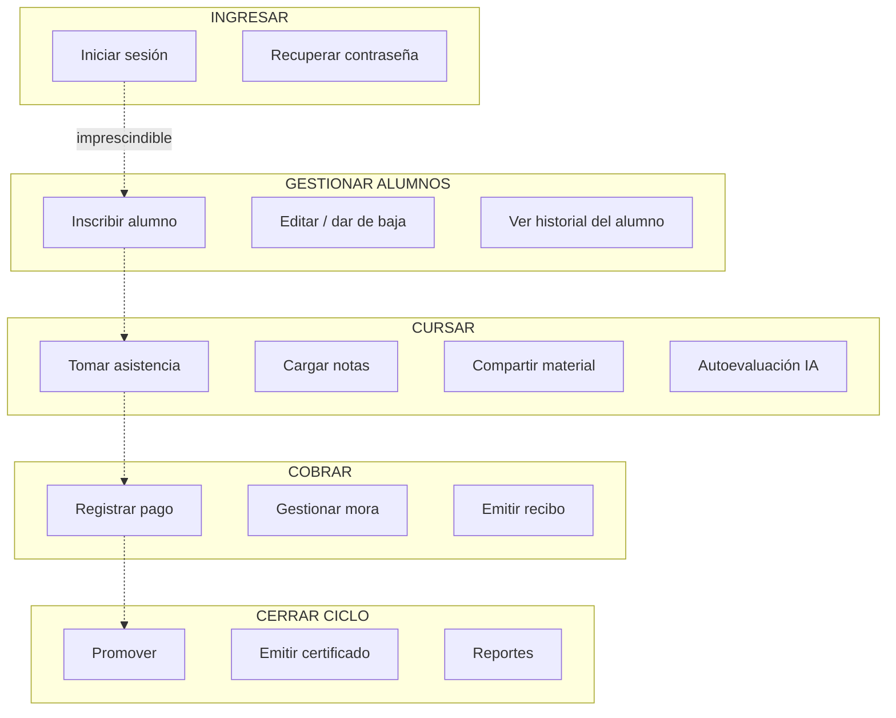

# Encuentro 2 — Validación de dominio

**Pregunta eje:** ¿De qué trata esto y tiene sentido el modelo?

Documento de análisis funcional (FN). Sostiene los tres requisitos del encuentro:
procesos del negocio relevados, actores identificados y justificación de cada entidad
del DER desde el negocio real.

> **Fuentes.** Todo lo que sigue está fundado en tres registros:
> 1. **Relevamiento institucional de Práctica Profesionalizante I** (octubre 2025) —
>    IICANA filial Pueyrredón. 10 procesos clave, organigrama, políticas, KPIs y
>    diagnóstico. Citado como **[REL-2025]**.
> 2. **Relevamiento con la Directora** (mayo 2026) — `SCRUM-191` y sus 12 historias
>    hijas, más `SCRUM-170`. Citado como **[REL-2026]**.
> 3. El **modelo de datos implementado** (`src/lib/drizzle/schema.ts`) y el código.

---

## 1. El negocio

**Instituto Cultural Argentino Norteamericano (IICANA) — filial Pueyrredón.**
Centro binacional de enseñanza de inglés fundado en 1963; la filial Pueyrredón se abrió
en 1998 en Gral. Román Deheza 1462, Córdoba. Cada filial gestiona su administración
de forma autónoma. [REL-2025]

| Dato del negocio | Valor | Fuente |
|---|---|---|
| Alumnos de la filial | ~250 por semestre | [REL-2025] |
| Alumnos de toda la institución | +1.500 anuales, ~60 docentes | [REL-2025] |
| Aulas disponibles | 3 (limita los cursos simultáneos) | [REL-2025] |
| Cupo por curso | 15 alumnos | [REL-2025] |
| Edad mínima de ingreso | 6 años cumplidos | [REL-2026] `SCRUM-186` |
| Turnos | Mañana, tarde y noche (8–13 y 15–21 hs) | [REL-2025] |
| Vencimiento de cuota | Día 10 de cada mes | ambos |
| Mora → recordatorio | 15 días | [REL-2025] |
| Mora → baja temporal | 30 días | [REL-2025] |
| Fuentes de ingreso | Cuotas, matrícula anual, venta de materiales, cursos de verano | [REL-2025] |

### 1.1 El negocio sin sistema

Antes de Smart Learning la filial operaba con **planillas físicas, Google Sheets,
WhatsApp y un cuaderno de reclamos**, sobre **una sola notebook compartida**. [REL-2025]

Cómo funcionaba cada proceso:

| Proceso | Cómo se hacía sin sistema |
|---|---|
| **Inscripción** | Ficha de inscripción en papel → carga manual en Google Sheets. El cupo se verificaba consultando la planilla. Se cobraba matrícula anual + primera cuota. |
| **Asistencia** | El administrativo recibía la planilla impresa, pasaba lista en los primeros 10 minutos marcando "P" o "A", la entregaba a Dirección y la cargaba en Sheets **al final del día**. |
| **Notas** | El docente corregía (escala 1–10), anotaba en planilla impresa, y alguien cargaba después en Sheets. Los promedios se calculaban con fórmulas de la planilla. |
| **Pagos** | Cobro en mostrador o transferencia → registro manual en Sheets → **recibo escrito a mano**. Al día 11 se armaba el reporte de morosos a mano. |
| **Comunicación** | WhatsApp (muchas veces personal, no institucional), correo y cartelera física. El envío se anotaba en un cuaderno. |
| **Reclamos** | **Cuaderno de reclamos**: fecha, motivo y solicitante. |
| **Alertas de ausencia** | Manuales: si alguien notaba 2 faltas seguidas, mandaba un WhatsApp al tutor. |
| **Cierre de ciclo** | Consolidación manual de notas, asistencia y pagos. **Podía llevar más de una semana.** |

**Los 10 problemas que el relevamiento identificó** [REL-2025]: gestión manual y
dispersa; errores y duplicación de registros; falta de trazabilidad del alumno;
sin indicadores automatizados; comunicación informal sin registro; sin control
centralizado de recursos; sin información en tiempo real para la Dirección;
**imposibilidad de detectar alumnos en riesgo a tiempo**; cierre de ciclo extenso;
y sin historial comparativo entre períodos.

**Efecto más grave, en palabras del relevamiento:** *"Alumnos que abandonan sin que la
institución lo detecte a tiempo para intervenir."*

Esa frase es la que justifica el módulo de detección de riesgo. Conviene citarla
textual en el coloquio: la funcionalidad más sofisticada del sistema responde a un
dolor que el cliente nombró, no a una idea del equipo.

### 1.2 Situación actual vs. deseada

El relevamiento ya definió la meta por proceso. Esta tabla es la mejor evidencia de
trazabilidad requerimiento → sistema, porque muestra que lo construido responde punto
por punto a lo relevado. [REL-2025]

| Área | Antes | Meta relevada | ¿Cumplido hoy? |
|---|---|---|---|
| Inscripción | Papel + Sheets, ~15 min | 100% digital con validación automática | ✅ |
| Asistencia | Carga con hasta 3 días de retraso, sin alertas | Registro en clase, alertas por 2 ausencias | ✅ |
| Evaluación | Papel, publicación demorada | Notas online, cálculo automático | ✅ |
| Pagos | Recibos a mano, recordatorios manuales | Estado de cuenta, recibos digitales, alertas de vencimiento | ✅ |
| Comunicación | WhatsApp personal | Canal institucional con trazabilidad | ✅ (por email y notificación interna, no WhatsApp — ver 6.3) |
| Reportes | Manual y esporádico | Dashboard en tiempo real + export | ✅ |
| Evaluación docente | Encuestas en papel | Encuestas digitales con comparativa | ✅ |
| Historial académico | Fragmentado | Unificado por alumno | ✅ |
| **Detección de riesgo** | **Reactiva: se detecta cuando ya abandonó** | **Proactiva con IA** | ✅ |
| Acceso a información | La Dirección pedía reportes y esperaba días | Acceso inmediato | ✅ |

---

## 2. Actores del negocio

Un actor del negocio existe en el instituto **independientemente del sistema**. Cada rol
del sistema deriva de uno de ellos.

| Actor | Qué hace en el instituto [REL-2025] | Rol en el sistema |
|---|---|---|
| **Directora** | Máxima autoridad de la filial. Planifica, aprueba altas/bajas de alumnos, supervisa docentes, decide cursos, horarios y cupos, atiende reclamos complejos, se comunica con Casa Central. | `director` |
| **Administrativas** | Núcleo operativo. Matrícula, control de asistencia, cobros y morosidad, comunicación con alumnos y tutores, informes básicos para Dirección. | `administrativo` |
| **Docentes** (part-time) | Dictan clase, cargan notas, evalúan el progreso, contactan familias, participan de reuniones pedagógicas. | `profesor` |
| **Alumnos** | Cursan, asisten, rinden, pagan, reclaman. | `alumno` |
| **Tutor responsable** | Paga la cuota del alumno menor y es el destinatario de los avisos. | ❌ sin rol — ver 5.3 |
| **Contadora externa** | No es personal de planta. Concilia ingresos mensualmente, hace el cierre contable, asesora en lo impositivo y supervisa cobranzas. | ❌ sin rol — ver 5.3 |
| **Casa Central IICANA** | Autoriza decisiones estratégicas y certificaciones. | — externo |
| **ARCA (ex AFIP)** | Recibe la declaración de cada pago no-efectivo y devuelve el CAE. | — externo [REL-2026] |

### 2.1 Por qué el rol `administrativo` existe

Es el mejor ejemplo de trazabilidad negocio → sistema del proyecto.

El diseño original tenía tres roles operativos. El rol `administrativo` **no salió de
una decisión técnica**: `SCRUM-170` lo funda en una necesidad del negocio —
*"El director actualmente concentra todas las operaciones. Con el crecimiento de la
institución, se necesita un perfil de secretaría/administración que pueda gestionar el
flujo diario sin riesgo de modificar configuraciones críticas."*

Y el relevamiento de 2025 ya lo respaldaba: la filial tiene **una Directora y tres
administrativas**, y son las administrativas quienes ejecutan inscripción, asistencia,
cobros y reclamos en los 10 procesos relevados.

El corte de permisos sigue esa división real:

- **Puede** (lo que hacen las administrativas): alumnos, inscripciones, pagos,
  asistencia, reclamos, notificaciones, reportes.
- **No puede** (lo que decide la Directora): usuarios, docentes, cursos, evaluación
  docente, autoevaluaciones IA, cierre de ciclo, marketing.

**El criterio es de negocio:** la secretaría ejecuta la operación del día; la Directora
define las reglas del instituto. Quien fija un precio, contrata un docente o decide
quién promociona es la Directora — y `src/proxy.ts` lo refleja bloqueando esas rutas.

---

## 3. Procesos del negocio

El relevamiento identificó **10 procesos clave**. Los tres siguientes son los que el
sistema atraviesa de punta a punta.

### 3.1 Proceso central — Ingreso y cursada

```
Consulta del aspirante
        │
        ▼
Test de nivelación (si no es principiante absoluto)
        │
        ▼
Inscripción ──────► valida: edad ≥ 6, cupo ≤ 15, sin duplicado, sin choque de horario
        │           cobra matrícula + primera cuota
        ▼
Cursada ──────────► asistencia clase a clase
        │           notas por evaluación
        │           cuota mensual, vence el día 10
        ▼
Cierre de ciclo ──► ¿asistencia y nota alcanzan el umbral?
        │              sí → promociona + certificado
        │              no → recursa el nivel con descuento
        ▼
Alumno promovido / graduado
```

> El "recursar con descuento" es una política real del instituto [REL-2025] que
> **el sistema no contempla**: hoy un enrollment no promovido queda `active` o
> `withdrawn`, sin registro de que el alumno recursa ni del descuento asociado.
> Ver 6.2.

### 3.2 Proceso de cobranza

```
Se genera la cuota (vence el día 10)
        │
        ├─ Días 1-10 ──► descuento según método; crédito: recargo [REL-2026]
        │
        ├─ Pago ───────► efectivo    → recibo del sistema
        │                no-efectivo → recibo + comprobante ARCA obligatorio
        │
        └─ Impago ─────► vence → 'overdue'
                         +15 días → alerta a Dirección    [REL-2025: recordatorio]
                         +30 días → suspende alumno       [REL-2025: baja temporal]
                         2 cuotas vencidas → restringe acceso al portal
```

Los tres escalones de mora del sistema **replican la política escrita del instituto**
(15 días → recordatorio, 30 días → baja temporal hasta regularizar). Implementados en
`payments.service.ts` y `automations/actions.ts`.

### 3.3 Proceso de seguimiento académico

El sistema no espera a que alguien pregunte: cruza señales y avisa.

| Disparador | Acción automática | Reemplaza a |
|---|---|---|
| 2 ausencias consecutivas | Notifica a Dirección | El WhatsApp manual del Proceso 2 |
| Alumno baja del 70% de asistencia | Alerta a docente y Dirección (solo la 1ª vez) | — no existía |
| Mora + asistencia baja + bajo rendimiento | Calcula riesgo de abandono (none/low/medium/high) | — no existía |
| Cada N clases del curso | Genera autoevaluación diagnóstica con IA | — no existía |

---

## 4. Justificación de cada entidad del DER

Cada entidad responde: **¿qué cosa del instituto representa y qué se rompería sin ella?**

### 4.1 Entidades maestras

| Entidad | Qué representa | Por qué es necesaria |
|---|---|---|
| `profiles` | Una persona con acceso al sistema y su rol | El instituto tiene cuatro tipos de personas con permisos distintos; sin esto no hay forma de saber quién es quién |
| `students` | Un alumno | Guarda lo propio de la condición de alumno (DNI, fecha de nacimiento para validar los 6 años, nivel, estado) que no aplica a un docente |
| `teachers` | Un docente contratado | La Directora necesita saber qué docente puede dictar qué nivel; el relevamiento registra ~10 docentes part-time con carga variable |
| `courses` | Un curso: nivel, horario, cupo, docente | Unidad de venta y de organización pedagógica. El cupo de 15 y la cuota viven acá. Limitado por las 3 aulas de la filial |

### 4.2 Entidades transaccionales

| Entidad | Qué representa | Por qué es necesaria |
|---|---|---|
| `enrollments` | El hecho de que un alumno se inscribió a un curso | Hace posible todo lo demás: sin inscripción no hay asistencia, notas ni promoción. Es donde viven las reglas de cupo, duplicado y choque de horario |
| `attendance` | La presencia en una clase concreta | Insumo del umbral de promoción y de las alertas de deserción. Reemplaza la planilla física que *"se extravía o deteriora"* [REL-2025] |
| `grades` | La calificación de una evaluación | Insumo del otro umbral. Se distingue por tipo (parcial, final, oral, tarea, quiz) porque no todas pesan igual |
| `payments` | Una cuota o matrícula, su vencimiento y su cobro | Sostiene el ingreso y la obligación fiscal. Reemplaza el **recibo escrito a mano sin trazabilidad digital** [REL-2025] |

### 4.3 Entidades de soporte

| Entidad | Qué representa | Origen en el negocio |
|---|---|---|
| `notifications` | Aviso interno a un usuario | Reemplaza el *"WhatsApp personal sin registro institucional"* [REL-2025] |
| `complaints` | Reclamo formal | Reemplaza el **cuaderno de reclamos** que *"puede perderse"* [REL-2025] |
| `documents` | Material de estudio del curso | `SCRUM-189` [REL-2026] |
| `assessments` / `assessment_attempts` | Autoevaluación diagnóstica y el intento del alumno | Detección temprana del alumno que no sigue el curso |
| `teacher_surveys` | Evaluación anónima del docente | Reemplaza las **encuestas en papel con análisis manual** [REL-2025] |
| `class_observations` | Observación de clase por Dirección | El relevamiento fija **2 observaciones por docente por cuatrimestre** |
| `student_risk_assessments` | Score de riesgo de abandono | RF-16 del anteproyecto |
| `marketing_campaigns` / `inquiries` | Campañas y consultas de aspirantes | Proceso 9 [REL-2025] — ⚠️ en baja, ver 5.3 |

---

## 5. DER a presentar

### 5.1 DER núcleo (10 entidades)

La consigna pide 8–12. El modelo tiene 17 tablas: se presenta el núcleo y el resto
como anexo. Mostrar las 17 sin jerarquizar se lee como falta de criterio.

```
profiles ──1:1──┬── students ──1:N── enrollments ──1:N── attendance
                │        │                 │
                │        │                 └──1:N── grades
                │        │
                │        └──1:N── payments
                │
                └── teachers ──1:N── courses ──1:N── enrollments

profiles ──1:N── notifications
students ──1:N── complaints
```

**Entidad transaccional principal:** `enrollments` — vincula las dos maestras centrales
y de ella cuelgan asistencia y notas.

### 5.2 Anexo

`documents`, `assessments`, `assessment_attempts`, `teacher_surveys`,
`class_observations`, `student_risk_assessments`.

### 5.3 Decisiones de alcance a defender

Tres ausencias que el docente puede señalar. Las tres son decisiones, no olvidos —
pero **dos de ellas contradicen el anteproyecto original**, así que hay que
presentarlas como cambio de alcance documentado, no como si nunca se hubieran pedido.

**El tutor no tiene portal.** ⚠️ El anteproyecto [REL-2025] **sí lo contemplaba**:
RF-14 lista los roles *"directora, Administrativa, Docente, Alumno, Tutor"* y el alcance
funcional incluye *"Portal web para alumnos y tutores"*. Hoy no existe el rol. La
defensa honesta: el instituto se relaciona formalmente con el alumno, el tutor paga
pero no opera el sistema; sumar un portal de tutores duplicaba la gestión de permisos
sobre datos del alumno. **Es una reducción de alcance consciente y hay que decir que
lo es.**

**La contadora externa no tiene rol.** Es un actor real que concilia ingresos todos los
meses y hace el cierre contable. Hoy accede a la información a través de la Directora.
Defensa: su trabajo es sobre el consolidado mensual, no sobre la operación diaria, y
los reportes Excel cubren esa necesidad. Candidato natural a Práctica III.

**El aspirante no es un alumno.** Vive en `inquiries` porque todavía no tiene
inscripción, ni cuota, ni asistencia. Convertirlo en `student` desde la consulta
contaminaría los indicadores con gente que nunca se inscribió. **Marketing además está
en baja por decisión del cliente** (`SCRUM-187`): presentarlo como *"módulo construido
que el cliente decidió dar de baja en el relevamiento de mayo"*.

---

## 5.4 Story Map inicial

Requisito del encuentro. Organizado como *actividades del usuario* (columnas) →
*tareas* (filas), priorizadas de arriba (imprescindible) hacia abajo.



| Actividad | Release 1 (MVP) | Release 2 | Práctica III |
|---|---|---|---|
| Ingresar | Login, invitación | — | — |
| Alumnos | Inscribir, editar, baja | Historial unificado | — |
| Cursar | Asistencia, notas | Material, autoevaluación IA | Chatbot |
| Cobrar | Registrar pago, recibo | Mora automática, anulación | Pago online, ARCA, matrícula |
| Cerrar ciclo | Promover, certificado | Reportes Excel, cierre | — |

## 5.5 Template de User Story

Formato adoptado por el equipo para el backlog en Jira:

```
Como <rol/actor del negocio>
quiero <acción concreta en el sistema>
para <valor/objetivo de negocio>

Criterios de aceptación:
- [ ] <condición verificable 1>
- [ ] <condición verificable 2>
- [ ] pnpm tsc --noEmit sin errores

Origen: <requerimiento / issue / sección del relevamiento>
```

**Ejemplo real** (`SCRUM-233`, creado en este proyecto):

> *Como* administrativa, *quiero* que un alumno pueda quedar en lista de espera cuando el
> curso está lleno, *para* no perder al interesado y avisarle apenas se libere una vacante.
> — con sus criterios de aceptación y origen en el flujograma del relevamiento.

Las 12 historias hijas de `SCRUM-191` siguen este mismo template.

---

## 6. ⚠️ Divergencias a resolver antes de los encuentros

### 6.1 Reglas de negocio que cambiaron entre relevamientos

Las reglas académicas **no las inventó el equipo**: vienen del relevamiento de 2025.
Lo que ocurrió es que la Directora **las cambió** en 2026 y el código todavía tiene las
viejas.

| Regla | [REL-2025] oct/2025 | [REL-2026] may/2026 | Implementado hoy |
|---|---|---|---|
| Asistencia mínima | **80%** | **70%** (`SCRUM-190`) | 80% ❌ desactualizado |
| Escala de notas | **1 a 10** | **0 a 100%** (`SCRUM-188`) | 1–10 ❌ desactualizado |
| Nota mínima | **7/10** | **70/100** | 7,0 ❌ desactualizado |
| Métodos de pago | efectivo y transferencia | + débito y crédito, con descuento y recargo (`SCRUM-180`) | `cash, transfer, card` ❌ incompleto |

**Cómo contarlo:** *"El umbral de 80% viene del relevamiento inicial de octubre 2025.
En la reunión de mayo 2026 la Directora lo bajó a 70% por criterio pedagógico, y está
registrado como `SCRUM-190` pendiente de implementar."* Eso es trazabilidad, y es una
respuesta fuerte. Lo que no se puede es presentar el 80% como vigente.

**Recomendación:** implementar `SCRUM-190` y `SCRUM-188` antes del Encuentro 5. Son dos
constantes, un schema de Zod y una migración `score × 10`.

### 6.2 Reglas relevadas que el sistema nunca implementó

| Regla del negocio [REL-2025] | Estado |
|---|---|
| *"Los alumnos con promedio inferior a 7 pueden recursar el nivel con descuento"* | ❌ sin modelar |
| *"Se permite el cambio de horario o grupo dentro del mismo cuatrimestre"* | ❌ sin modelar (hoy hay que dar de baja e inscribir de nuevo) |
| *"No se aceptan cheques"* | ✅ implícito: el enum no lo incluye |
| Descuento por adelantar el cuatrimestre completo (fidelización) | ❌ `SCRUM-183` pendiente |
| Lista de espera cuando no hay cupo | ❌ sin modelar — está en el flujograma de inscripción |

Ninguna es grave, pero conviene tenerlas listadas: si el docente pregunta *"¿qué pasa
si el curso está lleno?"*, la respuesta hoy es "el sistema lo rechaza", cuando el
negocio real dice "va a lista de espera y se avisa cuando haya cupo".

### 6.3 Divergencias del anteproyecto — para el Encuentro 1

**El Encuentro 1 pide "tecnologías elegidas y justificadas". El stack implementado no
es el del anteproyecto.**

| Componente | Anteproyecto [REL-2025] | Implementado |
|---|---|---|
| Frontend | ASP.NET con C# / React-NextJS (el doc dice ambas) | **Next.js 16 + React 19 + TypeScript** |
| Backend | C# con .NET Framework | **Server Actions de Next.js** |
| Base de datos | Microsoft SQL Server / MySQL (el doc dice ambas) | **PostgreSQL (Supabase)** |
| Hosting | Servidor Windows con IIS | **Vercel** |
| IA | Servicio Python con ML entrenado | **Claude API (`@anthropic-ai/sdk`)** |
| Notificaciones | WhatsApp Business API | **Email (Resend) + notificación interna** |

**La justificación real, y hay que contarla así:** el equipo arrancó con 4 integrantes y
**se fueron dos**. Con la mitad del equipo y el mismo alcance comprometido, sostener el
stack del anteproyecto (C#/.NET + SQL Server + IIS, tres capas separadas, servidor
propio a administrar) no era viable en el tiempo restante. Se eligió un stack más
rápido de desarrollar y más confiable de operar.

Cada decisión se desprende de esa restricción:

| Cambio | Por qué, con medio equipo |
|---|---|
| C#/.NET → **TypeScript en toda la pila** | Un solo lenguaje de frontend a backend: no hay que mantener dos bases de código ni una API REST intermedia. Menos superficie para dos personas |
| IIS/servidor Windows → **Vercel + Supabase** | Elimina por completo la administración de servidor, backups y despliegue que el anteproyecto asumía como trabajo del equipo |
| SQL Server → **PostgreSQL (Supabase)** | Viene con Auth, Storage y RLS integrados. El anteproyecto los daba por construir a mano |
| Python + modelo de ML entrenado → **Claude API** | El modelo del anteproyecto necesitaba un **dataset histórico que el instituto no tiene**, justamente porque no había sistema. Un modelo ya entrenado resuelve el requisito sin ese dato |
| WhatsApp Business API → **email (Resend)** | WhatsApp Business requiere aprobación de Meta y costo por mensaje. El email cumple el mismo requisito de trazabilidad institucional sin dependencia externa ni costo |

**Esta misma restricción explica otras tres cosas** — conviene presentarlas juntas, como
una sola decisión de gestión y no como tres carencias sueltas:

- La **reducción de alcance** del portal de tutores (F-08) y del chatbot SmartEnglish (F-07).
- El **Sprint 8 vencido**: el equipo se redujo a la mitad a mitad del cuatrimestre.
- La priorización de **automatizaciones** por sobre features manuales: con menos gente,
  que el sistema decida solo vale más que una pantalla más.

> **Para el SM:** la pérdida de dos integrantes es un **impedimento del proyecto**, que es
> exactamente lo que un Scrum Master documenta y gestiona. Presentado así, deja de ser una
> debilidad y pasa a ser evidencia de gestión: se detectó, se reajustó el alcance y se
> eligió una tecnología acorde a la nueva capacidad del equipo. Registrarlo en la
> retrospectiva del sprint correspondiente.

**Fuera de alcance en Fase 1 que después entró:** el anteproyecto excluía
explícitamente *"facturación electrónica AFIP"*, y `SCRUM-184` la pide como
obligatoria. Es una ampliación de alcance pedida por el cliente — vale, pero hay que
nombrarla.

**RF-17 (chatbot SmartEnglish) no está implementado.** Va al backlog honesto del
Encuentro 7 como entrega a Práctica III.

### 6.4 Errores internos del documento de relevamiento

Detectados al cruzar sus propias secciones. Conviene corregirlos antes de volver a
presentarlo, porque un docente que lea con atención los encuentra:

| Dónde | Problema |
|---|---|
| Funciones de la Directora (p. 12) | Incluye *"dictado de clases"*, *"carga de notas"* y *"preparación de materiales didácticos"* — son funciones del docente, quedaron pegadas por error |
| Administrativas | El título dice **2 personas**; Recursos Humanos dice **3 administrativas**; el organigrama muestra **3 secretarios** |
| Docentes | El título dice **20 docentes part-time**; Recursos Humanos dice **10 profesores** |
| Flujograma de promoción (p. 40) | La condición dice *"Promedio mayor o igual a **6**"*; todo el resto del documento dice **≥ 7** |
| Historia | Dice *"nacido en 1963"* y la conclusión habla de **65 años de historia** (serían 62 a 2025) |
| Proceso 2 | *"El administrativo pasa lista"*, pero la situación deseada y el RF-04 dicen que la asistencia la toma **el docente** |

El último no es un error de tipeo sino una definición: **conviene aclarar quién toma
asistencia**, porque el sistema hoy lo permite a `profesor`, `administrativo` y
`director`. Si el docente pregunta "¿quién toma lista?", hay que tener una respuesta
sola.

---

## 7. Preguntas abiertas para la próxima reunión con el cliente

1. **Porcentajes exactos** de descuento por efectivo, por transferencia/débito y
   recargo por crédito (`SCRUM-180` los deja configurables pero sin valores).
2. **Monto de matrícula** por curso y si varía según nivel (`SCRUM-181`).
3. ¿La asistencia la toma el **docente** o el **administrativo**? (ver 6.4)
4. ¿Se modela la **lista de espera** cuando el curso llega a 15?
5. ¿Se modela el **recursado con descuento** del alumno no promovido?
6. ¿El alumno suspendido por mora que regulariza vuelve automáticamente a `active` o
   requiere decisión de Dirección?
7. ¿La **contadora externa** necesita acceso propio al sistema, o alcanza con los
   reportes que le pasa la Dirección?
