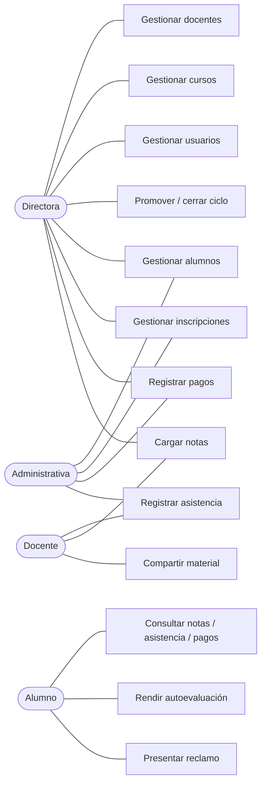

# Encuentro 3 — Datos base

**Pregunta eje:** ¿Puedo cargar los datos base del sistema?

Cubre: casos de uso, diccionario de datos, distinción maestras/transaccionales y la
matriz de ABM completo. Cada ABM se justifica por un actor que lo necesita.

---

## 1. Maestras vs. transaccionales

**Entidad maestra:** representa algo que existe de forma estable en el instituto (una
persona, un curso). Se da de alta una vez y se consulta muchas.

**Entidad transaccional:** registra un hecho que ocurre en el tiempo (una asistencia, un
pago). Se generan de a muchas, crecen sin límite y son el insumo de los cálculos.

| Maestras | Transaccionales | De soporte |
|---|---|---|
| `profiles` | `enrollments` | `notifications` |
| `students` | `attendance` | `complaints` |
| `teachers` | `grades` | `documents` |
| `courses` | `payments` | `assessments` / `assessment_attempts` |
| | | `teacher_surveys` / `class_observations` |
| | | `marketing_campaigns` / `inquiries` |
| | | `student_risk_assessments` |
| | | `notification_settings` / `user_notification_preferences` |

---

## 2. Casos de uso

Cada ABM responde a un actor real del negocio. La consigna pide que *cada ABM esté
justificado por un actor que lo necesita* — esta es esa justificación.

### 2.1 Diagrama de casos de uso (núcleo)

### 2.2 Justificación ABM → actor

| ABM | ¿Qué actor lo necesita y para qué? |
|---|---|
| **Alumnos** | La *administrativa* matricula a cada alumno nuevo y actualiza sus datos. Es el primer paso de todo el flujo del negocio |
| **Docentes** | La *Directora* contrata y da de baja docentes; necesita saber quién puede dictar qué nivel |
| **Cursos** | La *Directora* define la oferta: nivel, horario, cupo, docente a cargo. Es la unidad de venta del instituto |
| **Inscripciones** | La *administrativa* inscribe al alumno en un curso; es lo que habilita asistencia, notas y pagos |
| **Asistencia** | El *docente* (o la administrativa) toma lista cada clase; alimenta el umbral de promoción |
| **Notas** | El *docente* califica cada evaluación; el otro insumo de la promoción |
| **Pagos** | La *administrativa* cobra la cuota y emite el recibo; sostiene el ingreso del instituto |
| **Reclamos** | El *alumno* presenta el reclamo; la *administrativa* o la *Directora* lo resuelve |
| **Usuarios** | La *Directora* crea cuentas de personal (administrativas) y gestiona accesos |

---

## 3. Diccionario de datos

Significado de negocio de cada campo. Tipos según `src/lib/drizzle/schema.ts`.

### 3.1 `profiles` — persona con acceso al sistema (maestra)

| Campo | Tipo | Significado |
|---|---|---|
| `id` | uuid (PK) | Igual al id de `auth.users` de Supabase |
| `email` | text, único | Email de acceso; también identifica al usuario en la invitación |
| `role` | enum | `director` / `administrativo` / `profesor` / `alumno` |
| `full_name` | text | Nombre y apellido |
| `phone` | text, opcional | Teléfono de contacto |
| `avatar_url` | text, opcional | Foto de perfil (Storage) |
| `created_at` / `updated_at` | timestamptz | Auditoría |

### 3.2 `students` — alumno (maestra)

| Campo | Tipo | Significado |
|---|---|---|
| `id` | uuid (PK) | — |
| `profile_id` | uuid (FK→profiles) | La persona detrás del alumno |
| `dni` | text, único | Documento; no puede repetirse |
| `birth_date` | date | Fecha de nacimiento; valida la edad mínima de 6 años |
| `level` | enum, opcional | Nivel de inglés actual |
| `placement_test_score` | integer, opcional | Puntaje del test de nivelación al ingresar |
| `status` | enum | `active` / `inactive` / `suspended` / `graduated` |
| `access_restricted` | boolean | Portal bloqueado por morosidad acumulada (2+ cuotas) |
| `created_at` / `updated_at` | timestamptz | Auditoría |

### 3.3 `teachers` — docente (maestra)

| Campo | Tipo | Significado |
|---|---|---|
| `id` | uuid (PK) | — |
| `profile_id` | uuid (FK→profiles) | La persona detrás del docente |
| `dni` | text, único | Documento |
| `specialization` | text, opcional | Especialización o certificación |

### 3.4 `courses` — curso (maestra)

| Campo | Tipo | Significado |
|---|---|---|
| `id` | uuid (PK) | — |
| `name` | text | Nombre del curso |
| `level` | enum | Nivel que dicta |
| `schedule` | text | Horario legible ("Lun/Mié 18:00–19:30"), generado desde los campos siguientes |
| `class_days` | enum[] | Días de la semana en que se dicta |
| `class_time` | time | Hora de inicio |
| `class_duration_minutes` | integer (def. 90) | Duración de la clase (15–240) |
| `classroom` | text, opcional | Aula asignada (la filial tiene 3) |
| `max_capacity` | integer (def. 15) | Cupo máximo — regla de negocio |
| `teacher_id` | uuid (FK→teachers) | Docente a cargo |
| `diagnostic_frequency` | integer (def. 0) | Cada cuántas clases se dispara una autoevaluación IA; 0 = desactivado |
| `status` | enum | `active` / `inactive` / `completed` |

### 3.5 `enrollments` — inscripción (transaccional principal)

| Campo | Tipo | Significado |
|---|---|---|
| `id` | uuid (PK) | — |
| `student_id` | uuid (FK→students) | Alumno inscripto |
| `course_id` | uuid (FK→courses) | Curso |
| `enrolled_at` | timestamptz | Fecha de inscripción |
| `status` | enum | `active` / `completed` / `withdrawn` |
| `completed_at` | timestamptz, opcional | Fecha de promoción |

> Índice único parcial en `(student_id, course_id) WHERE status = 'active'`: impide dos
> inscripciones activas del mismo alumno al mismo curso.

### 3.6 `attendance` — asistencia (transaccional)

| Campo | Tipo | Significado |
|---|---|---|
| `id` | uuid (PK) | — |
| `enrollment_id` | uuid (FK→enrollments) | A qué inscripción pertenece |
| `class_date` | date | Fecha de la clase |
| `status` | enum | `present` / `absent` / `late` |
| `notes` | text, opcional | Observación |
| `updated_at` | timestamptz, opcional | Cuándo se corrigió (null si es el registro original) |
| `updated_by` | uuid (FK→profiles), opcional | Quién corrigió |

> Constraint único `(enrollment_id, class_date)`: un solo registro por alumno y fecha.

### 3.7 `grades` — calificación (transaccional)

| Campo | Tipo | Significado |
|---|---|---|
| `id` | uuid (PK) | — |
| `enrollment_id` | uuid (FK→enrollments) | A qué inscripción pertenece |
| `evaluation_type` | enum | `parcial` / `final` / `oral` / `homework` / `quiz` |
| `score` | numeric(4,2) | Nota — hoy escala 1,00–10,00 (⚠️ el cliente pidió 0–100, `SCRUM-188`) |
| `evaluated_at` | timestamptz | Fecha de la evaluación |
| `notes` | text, opcional | Observación del docente |

### 3.8 `payments` — pago (transaccional)

| Campo | Tipo | Significado |
|---|---|---|
| `id` | uuid (PK) | — |
| `student_id` | uuid (FK→students) | Alumno |
| `amount` | numeric(10,2) | Monto |
| `due_date` | date | Vencimiento (día 10) |
| `paid_at` | timestamptz, opcional | Fecha de cobro; null si no pagó |
| `method` | enum, opcional | `cash` / `transfer` / `card` |
| `status` | enum | `pending` / `paid` / `overdue` / `suspended` / `cancelled` |
| `receipt_number` | text, único, opcional | Número de recibo |
| `notes` | text, opcional | Observación |
| `overdue_alert_sent_at` | timestamptz, opcional | Cuándo se envió la alerta de mora |
| `cancelled_at` | timestamptz, opcional | Cuándo se anuló |
| `cancelled_by` | uuid (FK→profiles), opcional | Quién anuló |
| `cancellation_reason` | text, opcional | Motivo de la anulación |

### 3.9 Entidades de soporte (resumen)

| Entidad | Campos clave | Significado |
|---|---|---|
| `notifications` | `user_id`, `type`, `title`, `body`, `read`, `batch_id` | Aviso interno a un usuario |
| `complaints` | `user_id`, `type`, `description`, `status`, `resolved_at` | Reclamo formal con estado |
| `documents` | `name`, `file_url`, `mime_type`, `uploaded_by_id` | Material de estudio (Storage) |
| `assessments` | `course_id`, `week_label`, `topic`, `status`, `questions` (JSONB) | Autoevaluación IA por curso |
| `assessment_attempts` | `assessment_id`, `student_id`, `answers`, `score` | Respuesta del alumno (0–100) |
| `teacher_surveys` | `teacher_id`, `course_id`, `rating1..4`, `comment` | Encuesta anónima del docente |
| `class_observations` | `teacher_id`, `observed_by`, `overall_rating`, `observations` | Observación de clase por Dirección |
| `marketing_campaigns` | `name`, `channel`, `budget`, `start_date` | Campaña publicitaria |
| `inquiries` | `name`, `email`, `campaign_id`, `status` | Consulta de un aspirante |
| `student_risk_assessments` | `student_id`, `risk_level`, `signals` (JSONB), `intervened_at` | Score de riesgo de abandono |
| `notification_settings` | `alert_type`, `enabled`, `timing_hours` | Config global de alertas |
| `user_notification_preferences` | `user_id`, `alert_type`, `enabled` | Opt-out por usuario y tipo |

---

## 4. Matriz de ABM

**A** = Alta, **B** = Baja, **M** = Modificación, **L** = Listado. ✅ implementado ·
📝 justificado sin implementar · ⬜ pendiente.

| Entidad | A | B | M | L | Acción principal |
|---|:-:|:-:|:-:|:-:|---|
| Alumnos | ✅ | ✅ | ✅ | ✅ | `createStudentAction` |
| Docentes | ✅ | ✅ | ✅ | ✅ | `createTeacherAction` |
| Cursos | ✅ | ✅ | ✅ | ✅ | `createCourseAction` |
| Inscripciones | ✅ | ✅ | ✅ | ✅ | `createEnrollmentAction` |
| Asistencia | ✅ | ✅ | ✅ | ✅ | `recordAttendanceAction` + `updateAttendanceAction` (¹) |
| Notas | ✅ | ✅ | ✅ | ✅ | `createGradeAction` |
| Pagos | ✅ | ✅ (²) | ✅ (²) | ✅ | `createPaymentAction` + `cancelPaymentAction` |
| Reclamos | ✅ | 📝 (³) | ✅ estado | ✅ | `createComplaintAction` |
| Documentos | ✅ | ✅ | 📝 (⁴) | ✅ | `uploadDocumentAction` |
| Autoevaluaciones | ✅ | ✅ archivar | 📝 (⁵) | ✅ | `generateAssessmentAction` |
| Usuarios | ✅ | ✅ ban | ✅ | ✅ | `createAdministrativoAction` |
| Encuestas docentes | ✅ | 📝 (⁶) | 📝 (⁶) | ✅ | `submitSurveyAction` |
| Observaciones de clase | ✅ | ⬜ | ⬜ | ✅ | `createObservationAction` |
| Campañas marketing | ✅ | ⬜ | ⬜ | ✅ | `createCampaignAction` — ⚠️ módulo en baja (`SCRUM-187`) |
| Consultas (inquiries) | ✅ | ⬜ | ✅ estado | ⬜ (⁷) | `createInquiryAction` |

**Notas de justificación:**

1. **Asistencia** — la corrección (`updateAttendanceAction`) y la baja de sesión
   (`deleteAttendanceSessionAction`) quedan trazadas con usuario y fecha, porque la
   asistencia alimenta la promoción y un cambio no puede ser anónimo.
2. **Pagos** — la "baja" es **anulación, no borrado**: el registro se conserva por
   trazabilidad contable. La modificación solo se permite sobre pagos no cobrados.
3. **Reclamos** — no se borran: se resuelven o cierran (estado). Es la baja lógica
   correcta para el negocio.
4. **Documentos** — un material se reemplaza subiendo la versión nueva y dando de baja la
   anterior; editar el archivo en su lugar rompería el historial del curso.
5. **Autoevaluaciones** — las genera la IA a partir del material; editarlas a mano
   rompería la relación con su fuente. Se archivan y se regeneran.
6. **Encuestas docentes** — son **anónimas**; editarlas o borrarlas selectivamente
   rompería la anonimidad.
7. **Consultas** — sin listado propio; se ven anidadas en el detalle de la campaña.
   Pendiente (hallazgo D-04). Se resuelve o se elimina junto con el módulo de marketing.

---

## 5. Validaciones de integridad

El sistema rechaza operaciones inválidas con mensaje explicativo. (Detalle completo en el
Encuentro 6.) Las principales de la carga base:

| Regla | Mensaje |
|---|---|
| Cupo lleno | "El curso alcanzó el cupo máximo de 15 alumnos" |
| Inscripción duplicada | "El alumno ya está inscripto en este curso" |
| Choque de horario | "El horario se superpone con el curso «…»" |
| Asistencia ya registrada | "La asistencia de esta fecha ya fue registrada" |
| DNI duplicado | "Ya existe un alumno registrado con ese DNI" |
| Nota fuera de rango | "La nota mínima es 1" / "La nota máxima es 10" |
| Edad mínima | "El alumno debe tener al menos 6 años de edad" (⚠️ `SCRUM-186`, pendiente) |

---

## 6. Gestión del sprint (SM)

Requisito del encuentro: Sprint 1 documentado, backlog consistente, dailies registradas
y retrospectiva.

- **Backlog:** épicas por módulo en Jira (proyecto SCRUM), consistentes con los ABM
  demostrados.
- **Dailies y retrospectiva:** ⬜ **a completar por el equipo** — las actas y la retro no
  están en el repositorio; hay que redactarlas (aunque sea retroactivamente).
- **Métricas:** comprometido vs. completado por sprint, a sacar del board.
