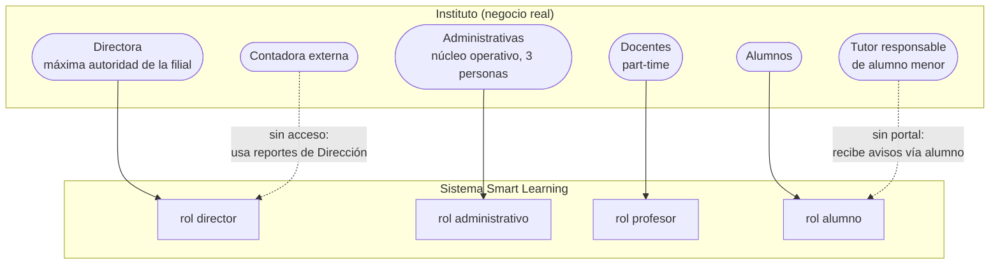

# Encuentro 4 — Identidad del sistema

**Pregunta eje:** ¿Puedo entrar y el sistema sabe quién soy?

Cubre: diagrama de actores del negocio, cada rol como derivación de un actor real,
permisos justificados desde el negocio y el login funcionando.

---

## 1. Diagrama de actores del negocio

Cada actor existe en el instituto **independientemente del sistema**. El rol del sistema
deriva del actor, no al revés.



Los actores **Casa Central IICANA** y **ARCA** (fiscal) son sistemas/organismos externos,
sin rol en el sistema.

---

## 2. Cada rol surge de un proceso del negocio

| Rol | Actor del negocio | Qué proceso realiza (por qué existe el rol) |
|---|---|---|
| `director` | Directora | Define la oferta (cursos, precios), contrata docentes, decide promociones y cierre de ciclo, responde por lo fiscal. **Configura las reglas del instituto.** |
| `administrativo` | Administrativas | Inscribe, cobra, toma asistencia, atiende reclamos y consultas. **Ejecuta la operación del día.** |
| `profesor` | Docentes | Dicta, toma lista, califica, comparte material. **Lleva adelante la cursada.** |
| `alumno` | Alumnos | Cursa, consulta sus notas/asistencia/pagos, rinde autoevaluaciones, reclama. **Es el destinatario del servicio.** |

### 2.1 Por qué el rol `administrativo` es de negocio, no técnico

El diseño original tenía tres roles operativos. El `administrativo` nació de una necesidad
del negocio detectada en el relevamiento (`SCRUM-170`): *"El director actualmente
concentra todas las operaciones. Con el crecimiento de la institución, se necesita un
perfil de secretaría que gestione el flujo diario sin riesgo de modificar
configuraciones críticas."*

El corte de permisos **replica la división real de trabajo** de la filial: una Directora
que decide las reglas y tres administrativas que operan el día. No se diseñó desde lo
técnico; se copió la estructura del instituto.

---

## 3. Permisos justificados desde el negocio

El rol `administrativo` **puede** hacer lo que hacen las administrativas y **no puede**
tocar lo que decide la Directora. La regla no es técnica: es "¿quién hace esto en el
instituto real?".

| Sección | ¿`administrativo` puede? | Justificación de negocio |
|---|:-:|---|
| Alumnos | ✅ | Las administrativas matriculan y actualizan datos |
| Inscripciones | ✅ | Inscriben al alumno en el curso |
| Pagos | ✅ | Cobran la cuota y emiten recibo |
| Asistencia | ✅ | Cargan la asistencia diaria |
| Reclamos | ✅ | Reciben y gestionan reclamos |
| Notificaciones | ✅ | Envían avisos a alumnos y tutores |
| Notas | ✅ solo lectura | Ven las notas para atención al público; no las cargan |
| **Usuarios** | ❌ | Crear cuentas de sistema es decisión de la Directora |
| **Docentes** | ❌ | Contratar y dar de baja docentes es de la Directora |
| **Cursos** | ❌ | Definir la oferta (precios, cupos, horarios) es estratégico |
| **Evaluación docente** | ❌ | La Directora evalúa a su equipo |
| **Autoevaluaciones IA** | ❌ | Configuración académica de la Directora |
| **Cierre de ciclo / promociones** | ❌ | Decisión académica de la Directora |
| **Marketing** | ❌ | Planificación estratégica de la Directora |

### 3.1 Cómo se hace cumplir técnicamente

Dos capas, para que el permiso no dependa de que la UI esconda un botón:

1. **`proxy.ts`** (Edge, antes de cada request): valida la sesión con
   `supabase.auth.getUser()` y, si el rol es `administrativo`, bloquea las rutas
   exclusivas de dirección redirigiendo a `/403`.

   ```
   ADMIN_ONLY_ROUTES = users, teachers, courses, teacher-evaluations,
                       assessments, year-end, marketing, promotions,
                       settings, profile
   ```

2. **`requireRole([...])`** al inicio de **cada** Server Action: aunque alguien llame la
   mutación directamente, la acción rechaza el rol no autorizado. (Mapa completo en el
   Encuentro 5, tabla de trazabilidad.)

---

## 4. Login funcionando

- **Autenticación:** Supabase Auth. La contraseña nunca viaja ni se guarda en claro.
- **Flujo de invitación:** la Directora/administrativa crea el usuario → el sistema
  genera un link `/invite/[email]` → Resend envía el email → el usuario establece su
  contraseña en `/update-password`.
- **Dos vistas distintas mínimas:** el sistema tiene **cuatro** landings, una por rol
  (`/director`, `/administrativo`, `/profesor`, `/alumno`), cada una mostrando solo lo
  que ese rol puede ver. Supera el requisito de "mínimo dos roles con vistas distintas".
- **Landing según rol:** el `layout.tsx` del dashboard lee el perfil y arma el sidebar
  con los ítems permitidos.

### 4.1 Los ABM del encuentro anterior siguen funcionando

Verificable con `pnpm tsc --noEmit` (sin errores) y los 159 tests unitarios en verde. La
carga base del Encuentro 3 no se rompió al sumar la capa de identidad.

---

## 5. Gestión (SM)

- **Roles validados con el cliente:** `SCRUM-170` (creación del rol administrativo) y
  `SCRUM-191` (relevamiento con la Directora) son la evidencia de que el corte de
  permisos se validó con el negocio, no se inventó.
- **Backlog actualizado y priorizado:** ver [hallazgos.md](hallazgos.md) para el estado
  real por prioridad.
