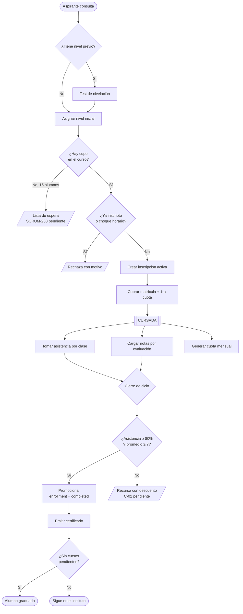
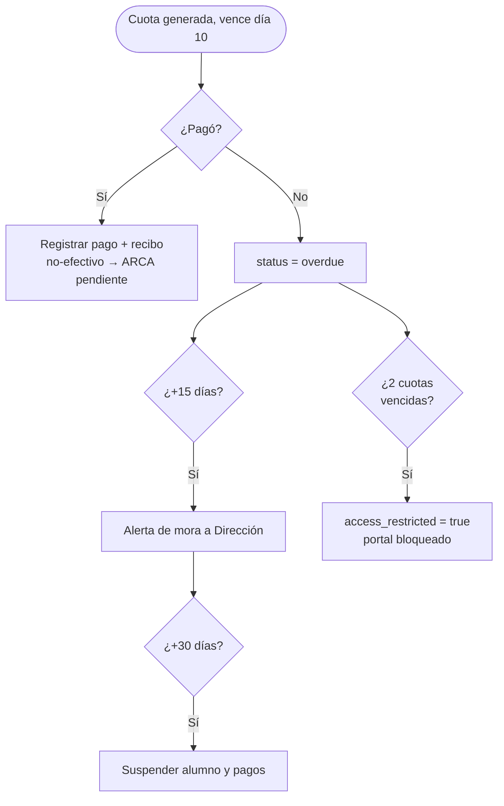

# Encuentro 5 — Lógica de negocio

**Pregunta eje:** ¿El sistema hace lo que dice que hace?

Cubre: reglas de negocio en lenguaje del cliente, BPMN del proceso principal, trazabilidad
regla → requerimiento, y la demostración de que el sistema **decide**, no solo guarda.

---

## 1. Reglas de negocio en lenguaje del cliente

Escritas como las diría la Directora, no como están en el código.

| # | Regla (lenguaje del cliente) | Dónde vive |
|---|---|---|
| R1 | "Un curso no puede tener más de 15 alumnos." | `courses.max_capacity` + `validateAndCreateEnrollment` |
| R2 | "Un alumno no se puede inscribir dos veces al mismo curso." | índice único parcial `enrollments` |
| R3 | "No puedo inscribir a alguien en dos cursos que se pisan de horario." | `schedulesOverlap` en enrollments |
| R4 | "Para promocionar hay que tener 80% de asistencia y 7 de promedio." | `promotions.service.ts:5-6` (⚠️ cliente pidió 70% y 70/100) |
| R5 | "La cuota vence el día 10." | `payments.due_date` |
| R6 | "A los 15 días de mora aviso; a los 30 lo suspendo." | `payments.service.ts` |
| R7 | "Si debe 2 cuotas, le corto el acceso al portal." | `automations/actions.ts` |
| R8 | "Si un alumno falta 2 veces seguidas, quiero enterarme." | `attendance/actions.ts` |
| R9 | "Quiero detectar antes a los que están por abandonar." | `risk-detection.service.ts` |
| R10 | "El alumno menor de 6 años no se inscribe." | `students/schemas.ts` (⚠️ `SCRUM-186` pendiente) |

---

## 2. BPMN — proceso central (inscripción → cursada → promoción)

Las cajas punteadas son partes del proceso del negocio que el sistema aún no modela
(lista de espera, recursado) — ver [hallazgos.md](hallazgos.md) C-01 y C-02.

### 2.1 Proceso de cobranza y mora

---

## 3. El sistema DECIDE, no solo guarda

La pregunta clave del encuentro es *"¿el sistema decide o solo guarda?"*. Estas son las 9
decisiones automáticas que el sistema toma sin que nadie se lo pida.

| # | Decisión automática | Regla | Archivo |
|---|---|---|---|
| 1 | Promociona o no a cada alumno | asistencia ≥ 80% **y** nota ≥ 7 | `promotions.service.ts:85` |
| 2 | Gradúa al alumno sin cursos pendientes | al consolidar el ciclo | `year-end.service.ts:170` |
| 3 | Marca la cuota como vencida | pendiente + vencida | `payments.service.ts:132` |
| 4 | Alerta a Dirección por mora | +15 días sin pagar | `payments.service.ts:151` |
| 5 | Suspende alumno y pagos | +30 días sin pagar | `payments.service.ts:184` |
| 6 | Restringe el acceso al portal | 2+ cuotas vencidas | `automations/actions.ts:78` |
| 7 | **Calcula el riesgo de abandono** | cruza mora + asistencia <70% + rendimiento <60% → none/low/medium/high | `risk-detection.service.ts:21` |
| 8 | Alerta por 2 ausencias consecutivas | 2 faltas seguidas | `attendance/actions.ts:36` |
| 9 | Genera una autoevaluación con IA | cada N clases del curso | `auto-assessment.service.ts:41` |

**La demostración estrella (decisión #7):** la detección de riesgo de abandono cruza tres
fuentes de datos independientes —pagos, asistencia y rendimiento— y emite un juicio
(nivel de riesgo) que **ningún humano pidió**. Eso es exactamente lo que el relevamiento
identificó como el dolor a resolver: *"Alumnos que abandonan sin que la institución lo
detecte a tiempo para intervenir."* El sistema no espera a que pregunten: avisa.

### 3.1 Procesamiento automático programado (5 crons diarios)

| Cron | Hora (UTC) | Qué hace |
|---|---|---|
| `class-reminder` | 23:00 | Recordatorio de clase de mañana, respetando opt-outs |
| `payment-reminder` | 12:00 | Aviso de cuota que vence en 3 días |
| `overdue-alert` | 11:00 | Alerta de cuotas ya vencidas |
| `daily-report` | 10:00 | Reporte diario por email a Dirección |
| `risk-detection` | 09:00 | Recalcula el riesgo de abandono de cada alumno activo |

---

## 4. Trazabilidad: cada regla implementada tiene origen en un requerimiento real

| Regla | Origen documentado |
|---|---|
| Cupo de 15 | `[REL-2025]` Proceso 1, control "cupo máximo por curso (15 alumnos)" |
| Vencimiento día 10 | `[REL-2025]` Políticas de Pago |
| Mora 15/30 días | `[REL-2025]` Políticas de Pago (recordatorio 15, baja 30) |
| Promoción por asistencia y nota | `[REL-2025]` Proceso 7, controles |
| 2 ausencias → aviso | `[REL-2025]` Proceso 2, "alerta por 2 ausencias consecutivas" |
| Detección de riesgo | `[REL-2025]` diagnóstico: "dificultad para detectar alumnos en riesgo" → RF-16 |
| Autoevaluación IA | Anteproyecto, módulo de IA |
| Rol administrativo y su corte de permisos | `SCRUM-170` |
| Umbral 70% / escala 0–100 | `[REL-2026]` `SCRUM-190`, `SCRUM-188` (pendientes) |

`[REL-2025]` = relevamiento institucional Práctica I · `[REL-2026]` = relevamiento con la
Directora (`SCRUM-191`).

### 4.1 Mapa acción → rol (control de acceso por Server Action)

Cada mutación exige rol al entrar. Extracto (mapa completo en el código):

| Módulo | Acción | Roles habilitados |
|---|---|---|
| Alumnos | crear/editar/baja | director, administrativo |
| Pagos | crear/cobrar/anular | director, administrativo |
| Asistencia | registrar/corregir | director, administrativo, profesor |
| Notas | crear/editar/baja | director, profesor |
| Cursos | crear/editar/baja | **director** |
| Docentes | crear/editar/baja | **director** |
| Usuarios | crear/ban/invitar | **director** |
| Promoción / cierre de ciclo | ejecutar | **director** |
| Autoevaluación | rendir | alumno |
| Encuesta docente | responder | alumno |

---

## 5. Gestión (SM) — la tensión con el cliente

Requisito del encuentro: *"Si el cliente no apareció: SM documenta el bloqueo, la
decisión tomada y el impacto en el backlog."*

Dos hechos de gestión a presentar honestamente:

1. **El cliente cambió reglas ya implementadas** (umbral de asistencia, escala de notas)
   en el relevamiento de mayo. El equipo las registró como `SCRUM-190`/`SCRUM-188` y las
   dejó pendientes de implementar. **Impacto en el backlog:** dos historias nuevas
   priorizadas para el próximo sprint.

2. **El equipo se redujo de 4 a 2 integrantes.** Es el impedimento central del proyecto.
   Se gestionó recortando alcance (portal de tutores, chatbot) y eligiendo un stack más
   productivo. Registrarlo en la retrospectiva del sprint correspondiente.

⬜ **A completar por el equipo:** actas de daily y métricas del sprint (comprometido vs.
completado), que no están en el repositorio.
