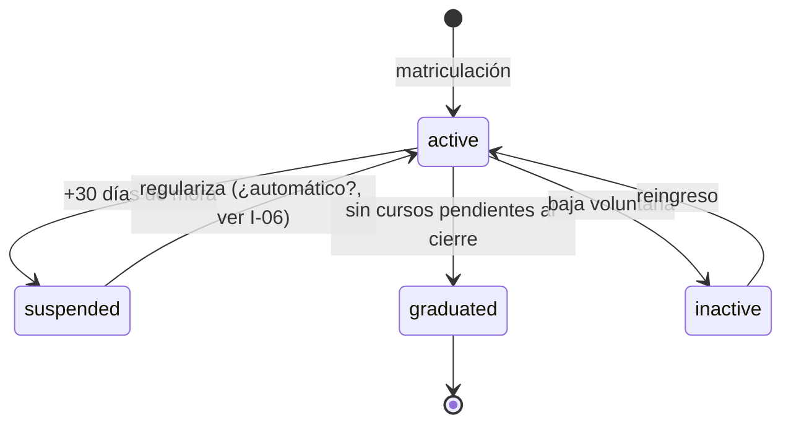
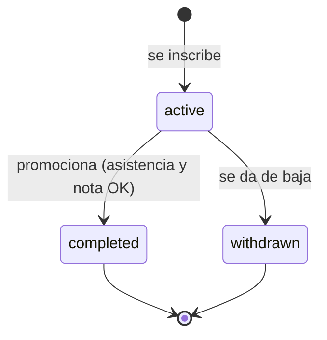
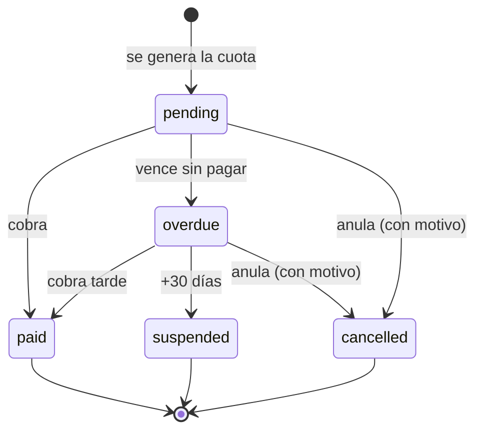
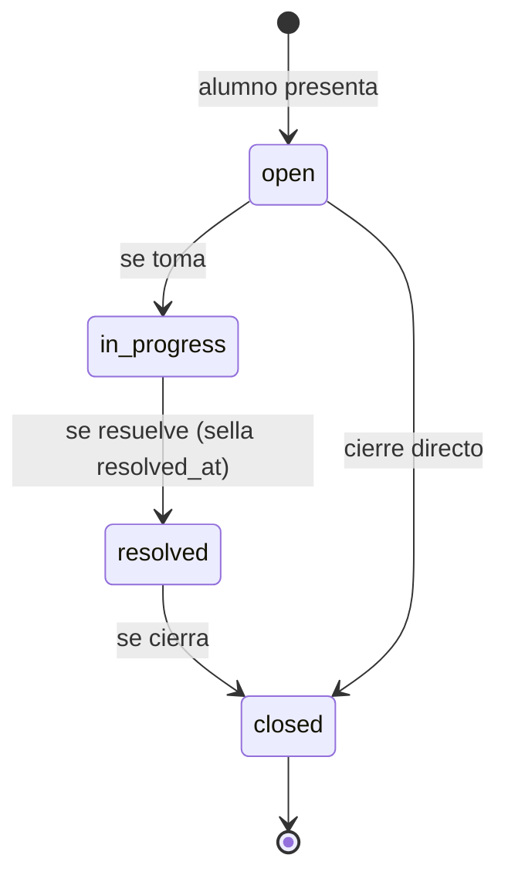
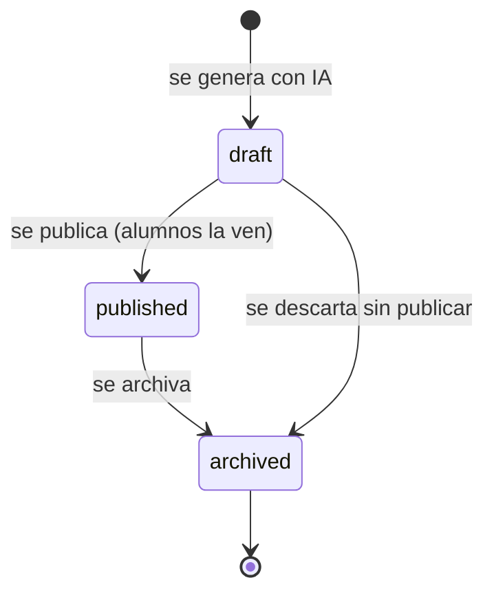

# Encuentro 6 — Casos borde

**Pregunta eje:** ¿Qué pasa cuando algo sale mal?

Cubre: diagramas de estado de las entidades principales, casos borde derivados de esos
estados, lista de excepciones que el sistema rechaza y por qué.

> Reemplaza al borrador `encuentro-6-casos-borde.docx` (previo a las correcciones de
> asistencia y pagos de julio 2026).

---

## 1. Diagramas de estado

Los casos borde se derivan de los estados, no se inventan. Estos son los cinco diagramas
de las entidades con ciclo de vida.

### 1.1 `student_status` — alumno

### 1.2 `enrollment_status` — inscripción

### 1.3 `payment_status` — pago

### 1.4 `complaint_status` — reclamo

### 1.5 `assessment_status` — autoevaluación

---

## 2. Casos borde derivados de los estados

| # | Situación borde | Qué hace el sistema |
|---|---|---|
| CB1 | Corregir una asistencia ya cargada | Permite corregir (`updateAttendanceAction`) y deja traza de quién y cuándo |
| CB2 | Clase cargada en el curso equivocado | Permite eliminar la sesión completa (`deleteAttendanceSessionAction`) |
| CB3 | Pago cargado con monto equivocado | Editable solo si no está cobrado; si ya se cobró, se anula y se registra de nuevo |
| CB4 | Anular un pago | Cambia a `cancelled` con motivo obligatorio; no se borra (trazabilidad contable) |
| CB5 | Doble submit del formulario de asistencia | `onConflictDoNothing` + constraint único evitan duplicados |
| CB6 | Dos inscripciones concurrentes al último cupo | `SELECT FOR UPDATE` serializa; el índice único es la red final |
| CB7 | Regularizar una cuota vencida | `overdue` → `paid`; el alumno suspendido debería reactivarse (⚠️ ver I-06) |
| CB8 | Alumno sin datos de asistencia al cierre | Se clasifica como `no_data`, no se promueve por error |
| CB9 | Curso lleno (15 alumnos) | Hoy rechaza; el negocio pide lista de espera (⚠️ `SCRUM-233`) |

---

## 3. Lista de excepciones — qué rechaza el sistema y por qué

Cada validación devuelve un mensaje que **explica** el rechazo (requisito del encuentro:
"el sistema explica por qué rechaza"). En español, orientado al usuario.

### 3.1 Inscripciones

| Rechaza | Mensaje | Por qué |
|---|---|---|
| Curso inexistente | "Curso no encontrado" | Integridad referencial |
| Duplicado activo | "El alumno ya está inscripto en este curso" | Regla R2 |
| Cupo lleno | "El curso alcanzó el cupo máximo de 15 alumnos" | Regla R1 |
| Choque de horario | "El horario se superpone con el curso «…»" | Regla R3 |

### 3.2 Asistencia y notas

| Rechaza | Mensaje |
|---|---|
| Asistencia duplicada por fecha | "La asistencia de esta fecha ya fue registrada" |
| Nota fuera de rango | "La nota mínima es 1" / "La nota máxima es 10" |

### 3.3 Pagos

| Rechaza | Mensaje |
|---|---|
| Monto ≤ 0 | "El monto debe ser mayor a 0" |
| Recibo duplicado | "Ya existe un pago con ese número de recibo" |
| Fecha inválida | "Ingresá una fecha válida" |
| Anulación sin motivo | "Explicá el motivo de la anulación (mínimo 10 caracteres)" |
| Editar pago ya cobrado | "Solo se puede editar un pago pendiente o vencido. Anulá el pago y registrá uno nuevo." |

### 3.4 Alumnos y usuarios

| Rechaza | Mensaje |
|---|---|
| DNI duplicado | "Ya existe un alumno registrado con ese DNI" |
| Email duplicado | "Ya existe un usuario con ese email" |
| Edad < 6 años | "El alumno debe tener al menos 6 años de edad" (⚠️ `SCRUM-186` pendiente) |

### 3.5 Documentos y reclamos

| Rechaza | Mensaje |
|---|---|
| Archivo > 10 MB | "El archivo no puede superar los 10 MB" |
| Formato no permitido | "Formato no permitido. Usá PDF, Word, imágenes o texto plano." |
| Reclamo muy corto | descripción mín. 20 caracteres |
| Evaluación docente duplicada | "Ya enviaste tu evaluación para este curso" |

---

## 4. Validaciones justificadas desde reglas del negocio

Ninguna validación es arbitraria; todas derivan de una regla del instituto:

- El **cupo de 15** viene de la capacidad real de las aulas.
- El **DNI único** evita el problema relevado de "duplicación de registros".
- La **edad mínima de 6 años** es la política de ingreso del instituto.
- La **anulación con motivo** (no borrado) responde a la necesidad de la contadora de
  auditar los movimientos.
- El **constraint de asistencia única** ataca directamente el problema relevado de
  "bloqueo de carga duplicada".

---

## 5. Concurrencia — el caso borde más técnico

Dos hallazgos resueltos este sprint, buen material para "Dev responde ante pedidos del
docente intentando romper el sistema":

- **Cupo e inscripción bajo concurrencia** (`SCRUM-231`): dos requests simultáneos podían
  burlar el cupo de 15 leyendo el mismo total antes de insertar. Resuelto con
  `SELECT ... FOR UPDATE` sobre el curso dentro de una transacción, más un índice único
  parcial como red de seguridad.
- **Asistencia duplicada** (`SCRUM-232`): constraint único `(enrollment_id, class_date)`
  + `onConflictDoNothing`, para que un doble submit no genere registros duplicados.

---

## 6. Gestión (SM)

- **Casos borde validados o justificados por el equipo:** los de la sección 2 están
  cubiertos; CB7 y CB9 quedan como decisiones abiertas para el cliente (I-06, `SCRUM-233`).
- **Retrospectiva con decisiones concretas:** ⬜ a redactar — incluir la decisión de
  resolver concurrencia con constraints de BD en vez de solo validación de aplicación.
