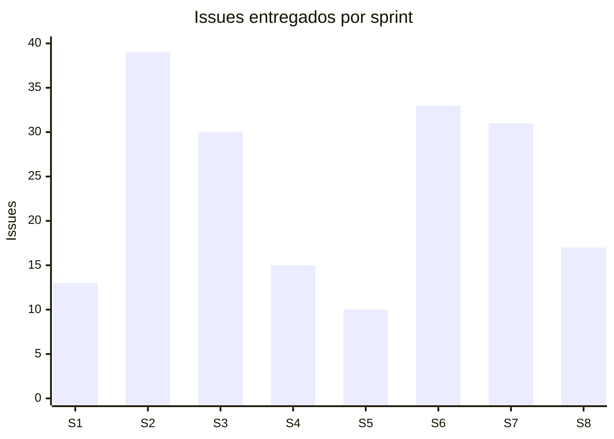
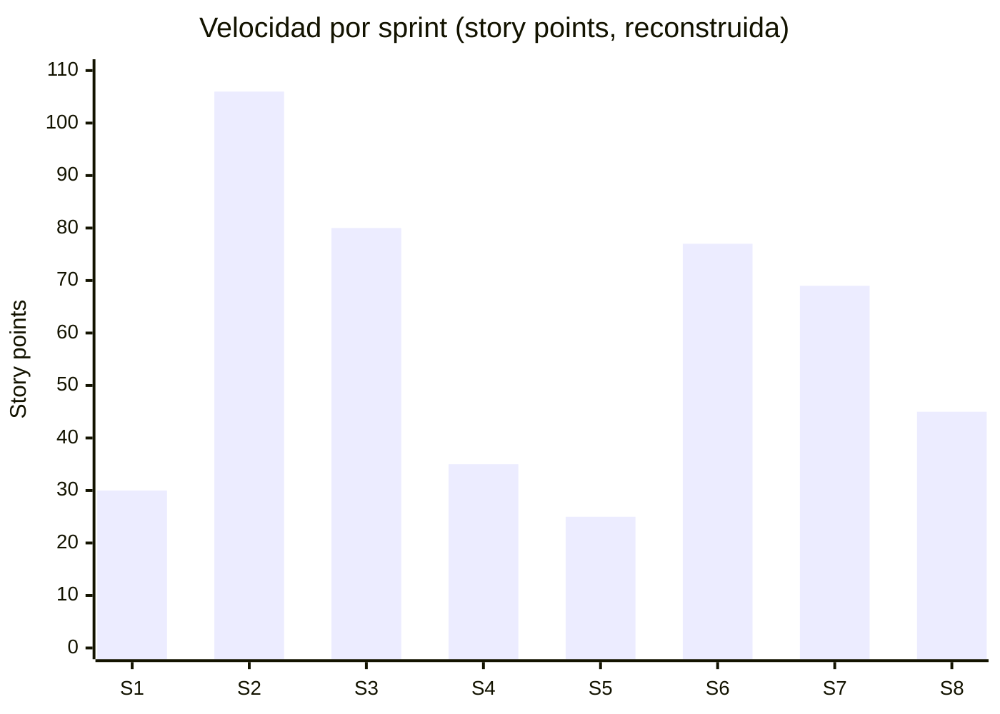

# Métricas de sprints — proyecto SCRUM (IICANA Smart Learning)

Datos extraídos del board de Jira el **21/07/2026**.

> **Nota metodológica — leer antes de usar.** Estos números salen de la **membresía
> actual** de cada sprint, donde **todos los issues figuran hoy como "Finalizado"**. Jira
> devuelve el estado actual, no el que el issue tenía al momento de cerrar el sprint. Por
> eso:
>
> - El **throughput** (issues entregados por sprint) es confiable.
> - El **"comprometido vs. completado al cierre"** exacto **no se puede reconstruir** desde
>   acá: hay issues que se movieron de un sprint al siguiente (carryover, ver §3). La
>   fuente autoritativa de esa métrica es el **Sprint Report nativo de Jira**
>   (Board → Reports → Sprint Report), que sí guarda la foto al cierre. Para la
>   presentación, conviene sacar captura de ese report por cada sprint.
> - **Story points cargados el 21/07/2026** en los ~150 issues de los sprints 1–8 (§4).
>   Ojo: esto **no** rellena el Velocity Report nativo de los sprints cerrados (§4.1) —
>   ese report usa fotos históricas congeladas al cierre y muestra Completed = 0. La
>   métrica de velocidad válida es la **reconstruida** de §4.1–4.2, no la del report nativo.

---

## 1. Throughput por sprint (issues entregados)

| Sprint | Fechas | Issues | Historias | Tareas | Bugs | Estado final |
|---|---|---:|---:|---:|---:|---|
| 0 | 19/01 – 02/02 | 0 (planificación) | — | — | — | Cerrado |
| 1 | 02/02 – 16/02 | 13 | 6 | 1 | 6 | 100% Done |
| 2 | 16/02 – 02/03 | 39 | 30 | 8 | 1 | 100% Done |
| 3 | 02/03 – 16/03 | 30 | 20 | 4 | 6 | 100% Done |
| 4 | 16/03 – 30/03 | 15 | 5 | 2 | 8 | 100% Done |
| 5 | 04/05 – 11/05 | 10 | 8 | 2 | 0 | 100% Done |
| 6 | 11/05 – 25/05 | 33 | ~14 | ~7 | ~12 | 100% Done |
| 7 | 27/05 – 11/06 | 31 | ~12 | ~13 | ~6 | 100% Done |
| 8 | 11/06 – 25/06 | 17 | 9 | 8 | 0 | 100% Done |

Los conteos de los sprints 6 y 7 llevan `~` porque incluyen issues arrastrados de sprints
previos (ver §3); el número total de issues del sprint es exacto, el desglose por tipo es
aproximado.

**Lectura para el coloquio:** la tasa de finalización es **100% en todos los sprints
ejecutados** — todo lo que entró a un sprint terminó cerrándose. Ese es el dato fuerte de
gestión.

---

## 2. Gráfico de entrega

Se ve el pico de los sprints 2–3 (construcción del núcleo) y una entrega sostenida hacia
el final aun con el equipo reducido.

---

## 3. Carryover — issues que se movieron entre sprints

Detectado al cruzar la membresía: varios issues aparecen en más de un sprint, señal de que
no se completaron en el sprint donde se comprometieron y se arrastraron al siguiente.

| Issues arrastrados | De → A |
|---|---|
| SCRUM-102 a 107, 123, 124, 134, 135 | Sprint 5 → Sprint 6 |
| SCRUM-129, 130, 131, 137 | Sprint 6 → Sprint 7 |

**Esto es normal en Scrum** y conviene presentarlo como tal: no todo lo comprometido entra
en un sprint, y el equipo repriorizó arrastrando al siguiente. Es material honesto para la
retrospectiva, no algo que ocultar.

> El Sprint 5 es el más chico (10 issues) y **todos** se arrastraron al 6. Coincide con el
> período de reducción del equipo — buen dato para la retro del Sprint 8.

---

## 4. Story points — cargados retroactivamente

El 21/07/2026 se cargaron story points en **todos** los issues de los sprints 1–8
(~150 issues), con una escala simple y uniforme para que la velocidad sea comparable
entre sprints:

| Tipo de issue | Puntos |
|---|---|
| Historia (Story) | 3 |
| Tarea (Task) | 2 |
| Bug | 2 |

Verificado: **0 issues sin puntos** en los 8 sprints tras la carga.

**Velocidad por sprint** (suma de puntos, comparable entre sprints):

| Sprint | Puntos | Issues |
|---|---:|---:|
| 1 | 30 | 13 |
| 2 | 106 | 39 |
| 3 | 80 | 30 |
| 4 | 35 | 15 |
| 5 | 25 | 10 |
| 6 | 77 | 33 |
| 7 | 69 | 31 |
| 8 | 45 | 17 |

> **Salvedad honesta sobre esta escala.** Los puntos se asignaron por **tipo de issue**,
> no por complejidad real estimada en su momento (el equipo no estimó durante los sprints).
> Es una reconstrucción razonable y consistente, pero la velocidad resultante es casi
> proporcional al conteo de issues. Si en el coloquio preguntan por el criterio de
> estimación, hay que decir esto: se estimó retroactivamente con una escala por tipo,
> porque no se había hecho story-point planning en su momento. Es la deuda de gestión que
> el equipo reconoce en la [retrospectiva del Sprint 8](retrospectiva-sprint-8.md).

### 4.1 ⚠️ Por qué el Velocity Report nativo de Jira NO sirve para estos sprints

Cargar los story points **no repara** el Velocity Report de los sprints ya cerrados. El
report usa dos fotos históricas, tomadas en el momento del sprint:

- **Commitment:** puntos de los issues presentes al **iniciar** el sprint.
- **Completed:** puntos de los issues terminados al **cerrar** el sprint.

Como los puntos se cargaron **después** de que los 8 sprints ya estaban cerrados, esas
fotos quedaron congeladas: el report muestra **Completed = 0 en los 8 sprints** (y
Commitment solo en los más recientes). **Esto no se puede corregir sin reabrir y
re-cerrar los sprints, lo que falsearía las fechas de cierre** — y eso no se hace.

**Consecuencia práctica:**

- Para los sprints **1 a 8** (cerrados): se usa la **tabla de velocidad reconstruida** de
  arriba y el gráfico de §4.2 como métrica del proyecto. **No** se presenta el Velocity
  Report nativo, porque quedó vacío por la razón explicada.
- Del Sprint **9 en adelante:** si se estima **antes** de arrancar cada sprint, el Velocity
  Report nativo se llena solo y pasa a ser la fuente válida.

### 4.2 Gráfico de velocidad reconstruida

Como los 8 sprints cerraron al 100%, la velocidad completada coincide con la comprometida.

Velocidad promedio: **58,4 puntos/sprint**. La caída del Sprint 5 (25) coincide con el
período de reducción del equipo; la recuperación en 6–8 muestra al equipo de 2 personas
sosteniendo la entrega.

---

## 5. Cómo generar los gráficos nativos de Jira

Ni este documento ni Rovo "generan" los gráficos: viven en Jira y se sacan por captura.

1. **Board → Reports.**
2. **Sprint Report** (por sprint): muestra comprometido vs. completado **al cierre** — es
   la métrica autoritativa que acá no se puede reconstruir.
3. **Velocity Report:** compara la velocidad entre sprints (necesita story points, §4).
4. **Burndown Chart** (por sprint): el descenso del trabajo pendiente día a día.

Para la presentación: una captura del Sprint Report de cada sprint + el Velocity Report
cubre por completo el requisito de "métricas del sprint" de la hoja de ruta.
