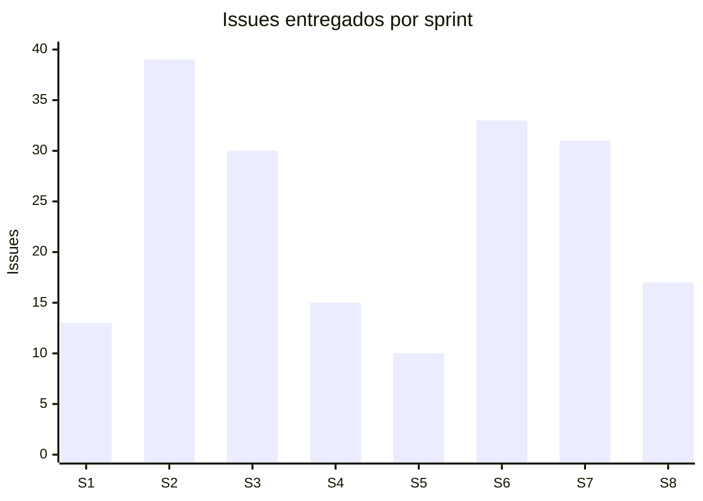

# Métricas de sprints — proyecto SCRUM (IICANA Smart Learning)

Datos extraídos del board de Jira el **21/07/2026**.

> **Nota metodológica — leer antes de usar.** Estos números salen de la **membresía
> actual** de cada sprint, donde **todos los issues figuran hoy como "Finalizado"**. Jira
> devuelve el estado actual, no el que el issue tenía al momento de cerrar el sprint. Por
> eso:
>
> - El **throughput** (issues entregados por sprint) es confiable.
> - El **"comprometido vs. completado al cierre"** exacto **no se puede reconstruir** desde
>   acá: hay issues que se movieron de un sprint al siguiente (carryover, ver §3). La
>   fuente autoritativa de esa métrica es el **Sprint Report nativo de Jira**
>   (Board → Reports → Sprint Report), que sí guarda la foto al cierre. Para la
>   presentación, conviene sacar captura de ese report por cada sprint.
> - **No hay story points cargados** en casi ningún issue (§4), así que no hay velocity
>   chart ni burndown por puntos. Las métricas de abajo son por **cantidad de issues**.

---

## 1. Throughput por sprint (issues entregados)

| Sprint | Fechas | Issues | Historias | Tareas | Bugs | Estado final |
|---|---|---:|---:|---:|---:|---|
| 0 | 19/01 – 02/02 | 0 (planificación) | — | — | — | Cerrado |
| 1 | 02/02 – 16/02 | 13 | 6 | 1 | 6 | 100% Done |
| 2 | 16/02 – 02/03 | 39 | 30 | 8 | 1 | 100% Done |
| 3 | 02/03 – 16/03 | 30 | 20 | 4 | 6 | 100% Done |
| 4 | 16/03 – 30/03 | 15 | 5 | 2 | 8 | 100% Done |
| 5 | 04/05 – 11/05 | 10 | 8 | 2 | 0 | 100% Done |
| 6 | 11/05 – 25/05 | 33 | ~14 | ~7 | ~12 | 100% Done |
| 7 | 27/05 – 11/06 | 31 | ~12 | ~13 | ~6 | 100% Done |
| 8 | 11/06 – 25/06 | 17 | 9 | 8 | 0 | 100% Done |

Los conteos de los sprints 6 y 7 llevan `~` porque incluyen issues arrastrados de sprints
previos (ver §3); el número total de issues del sprint es exacto, el desglose por tipo es
aproximado.

**Lectura para el coloquio:** la tasa de finalización es **100% en todos los sprints
ejecutados** — todo lo que entró a un sprint terminó cerrándose. Ese es el dato fuerte de
gestión.

---

## 2. Gráfico de entrega

Se ve el pico de los sprints 2–3 (construcción del núcleo) y una entrega sostenida hacia
el final aun con el equipo reducido.

---

## 3. Carryover — issues que se movieron entre sprints

Detectado al cruzar la membresía: varios issues aparecen en más de un sprint, señal de que
no se completaron en el sprint donde se comprometieron y se arrastraron al siguiente.

| Issues arrastrados | De → A |
|---|---|
| SCRUM-102 a 107, 123, 124, 134, 135 | Sprint 5 → Sprint 6 |
| SCRUM-129, 130, 131, 137 | Sprint 6 → Sprint 7 |

**Esto es normal en Scrum** y conviene presentarlo como tal: no todo lo comprometido entra
en un sprint, y el equipo repriorizó arrastrando al siguiente. Es material honesto para la
retrospectiva, no algo que ocultar.

> El Sprint 5 es el más chico (10 issues) y **todos** se arrastraron al 6. Coincide con el
> período de reducción del equipo — buen dato para la retro del Sprint 8.

---

## 4. ⚠️ Deuda de gestión: story points sin cargar

De todos los issues del proyecto, **solo `SCRUM-231` y `SCRUM-232` tienen story points**
(3 cada uno). El resto está en `null`.

**Consecuencia:** Jira no puede dibujar el **Velocity Chart** ni el **Burndown por
puntos** — esas dos gráficas, que son las que un docente espera ver en la columna de
gestión, van a salir vacías o planas.

**Dos caminos:**

1. **Dejarlo así** y presentar las métricas por cantidad de issues (esta tabla). Honesto,
   menos vistoso.
2. **Cargar story points retroactivos** a los issues de los sprints cerrados con una escala
   simple (p. ej. tarea chica = 2, historia mediana = 3, grande/épica = 5). Con eso, el
   Velocity Chart y el Burndown nativos de Jira se llenan solos. Es la métrica que la hoja
   de ruta insinúa cuando pide "muestra métricas".

> Si se elige el camino 2, hay que hacerlo sobre **todos** los sprints con el mismo
> criterio, para que la velocidad sea comparable entre sprints.

---

## 5. Cómo generar los gráficos nativos de Jira

Ni este documento ni Rovo "generan" los gráficos: viven en Jira y se sacan por captura.

1. **Board → Reports.**
2. **Sprint Report** (por sprint): muestra comprometido vs. completado **al cierre** — es
   la métrica autoritativa que acá no se puede reconstruir.
3. **Velocity Report:** compara la velocidad entre sprints (necesita story points, §4).
4. **Burndown Chart** (por sprint): el descenso del trabajo pendiente día a día.

Para la presentación: una captura del Sprint Report de cada sprint + el Velocity Report
cubre por completo el requisito de "métricas del sprint" de la hoja de ruta.
