# IICANA Smart Learning
## Práctica Profesionalizante II — Documentación de los 7 Encuentros

Sistema Integral de Gestión Académica y Administrativa
Instituto Cultural Argentino Norteamericano (IICANA) — Filial Pueyrredón, Córdoba

**Equipo:** Amilcar Amaya · Mayco Faciolo (Scrum Master)
**Product Owner:** Ing. Fernando Loza
**Fecha:** Julio 2026

---

## Índice

1. **Encuentro 1 — Informativo** · ¿Cómo vamos a trabajar?
2. **Encuentro 2 — Validación de dominio** · ¿De qué trata esto y tiene sentido el modelo?
3. **Encuentro 3 — Datos base** · ¿Puedo cargar los datos base del sistema?
4. **Encuentro 4 — Identidad del sistema** · ¿Puedo entrar y el sistema sabe quién soy?
5. **Encuentro 5 — Lógica de negocio** · ¿El sistema hace lo que dice que hace?
6. **Encuentro 6 — Casos borde** · ¿Qué pasa cuando algo sale mal?
7. **Encuentro 7 — Entregables** · ¿El sistema produce algo que el cliente puede llevarse?

**Anexo A — Métricas de sprints**
**Anexo B — Retrospectiva del Sprint 8**

---

Los diagramas de este documento (casos de uso, actores, BPMN, diagramas de estado,
gráficos de sprint) están escritos en Mermaid y se renderizan automáticamente. El
proyecto está desplegado en producción en `cervantes-smart-learning.com.ar`.


<div style="page-break-before: always;"></div>

# Encuentro 1 — Informativo

**Pregunta eje:** ¿Cómo vamos a trabajar?

Documento de presentación del proyecto, el sistema base, las tecnologías (justificadas)
y el Sprint 0.

---

## 1. El proyecto

**IICANA Smart Learning** — Sistema Integral de Gestión Académica y Administrativa para
el Instituto Cultural Argentino Norteamericano, filial Pueyrredón (Córdoba).

Es la continuidad de Práctica Profesionalizante I: en octubre 2025 se hizo el
relevamiento institucional; en Práctica II se construye el sistema que ese relevamiento
propuso.

**El problema que resuelve:** la filial operaba con planillas físicas, Google Sheets,
WhatsApp y una sola notebook compartida. Eso generaba duplicación de datos, errores de
carga, imposibilidad de detectar a tiempo a un alumno en riesgo de abandono, y un cierre
de ciclo que llevaba más de una semana. (Detalle en
[encuentro-2-dominio.md](encuentro-2-dominio.md) §1.)

**El objetivo del sistema:** gestionar la información de las actividades operativas de
IICANA y la trazabilidad completa del ciclo académico de cada alumno, desde su
inscripción hasta su egreso.

---

## 2. El equipo

| Integrante | Rol Scrum |
|---|---|
| Mayco Faciolo | **Scrum Master** |
| Amilcar Amaya | Equipo de desarrollo |
| Ing. Fernando Loza (docente) | **Product Owner** |

> **Nota de gestión (para el SM).** El equipo arrancó Práctica I con 4 integrantes
> (Amaya, Faciolo, y los dos Ferreyra) y a lo largo del proyecto **se redujo a la mitad**.
> Este hecho es el impedimento central del proyecto y explica varias decisiones que se
> presentan más adelante: la elección del stack, el alcance recortado y el ritmo de los
> sprints. Un Scrum Master documenta y gestiona los impedimentos — no los esconde.

---

## 3. El sistema base

Estado actual (julio 2026): **sistema funcional desplegado en producción** en
`cervantes-smart-learning.com.ar`.

Implementado y andando:

- Autenticación completa (login, invitación por email, recuperación de contraseña).
- Portales diferenciados para los 4 roles (director, administrativo, profesor, alumno).
- ABM de alumnos, docentes, cursos, inscripciones, notas y pagos.
- Asistencia digital con corrección trazable.
- Sistema de pagos con recibos, mora escalonada y anulación auditada.
- 9 automatizaciones (promoción, mora, riesgo de abandono, alertas de ausencia,
  autoevaluación IA, 5 crons diarios).
- Evaluación docente (encuestas anónimas + observaciones de clase).
- Notificaciones internas + email.
- Autoevaluaciones generadas por IA.
- Material de estudio por curso.
- Promociones, cierre de ciclo y certificados imprimibles.
- Reportes Excel (asistencia, notas, pagos).

---

## 4. Tecnologías elegidas y justificadas

### 4.1 El stack

| Capa | Tecnología | Versión |
|---|---|---|
| Framework | Next.js (App Router, server-first) | 16 |
| UI | React + TypeScript | 19 / 5 |
| Estilos | Tailwind CSS | 4 |
| Auth + Storage + BD | Supabase (`@supabase/ssr`) | — |
| ORM | Drizzle (sobre PostgreSQL) | 0.45 |
| IA | Claude API (`@anthropic-ai/sdk`) | — |
| Email | Resend | 6 |
| Validación | Zod | 4 |
| Hosting | Vercel | — |

### 4.2 La justificación — por qué NO es el stack del anteproyecto

El anteproyecto de Práctica I proponía **C# / .NET Framework + SQL Server + IIS**, un
servicio Python para la IA y WhatsApp Business API. El sistema **no** se construyó así,
y el motivo es de gestión antes que técnico: **el equipo pasó de 4 a 2 integrantes**.
Con la mitad de la gente y el mismo alcance comprometido, el stack del anteproyecto (tres
capas separadas + un servidor propio para administrar) no era sostenible en el tiempo
restante. Se eligió uno **más rápido de desarrollar y más confiable de operar.**

| Decisión | Anteproyecto | Elegido | Por qué, con medio equipo |
|---|---|---|---|
| Lenguaje | C# (backend) + JS (frontend) | **TypeScript en toda la pila** | Un solo lenguaje de punta a punta. No hay que mantener dos bases de código ni una API REST intermedia |
| Backend | .NET Framework + API REST | **Server Actions de Next.js** | Las mutaciones son funciones del servidor llamadas directo desde el formulario; menos capas, menos código |
| Base de datos | SQL Server | **PostgreSQL (Supabase)** | Trae Auth, Storage y seguridad a nivel de fila ya integrados; el anteproyecto los daba por construir a mano |
| Hosting | Servidor Windows + IIS | **Vercel** | Elimina la administración de servidor, backups y despliegue que el anteproyecto asumía como trabajo del equipo |
| IA | Python + modelo ML entrenado | **Claude API** | El modelo propuesto necesitaba un dataset histórico que el instituto no tiene, justamente porque no había sistema. Un modelo ya entrenado resuelve el requisito sin ese dato |
| Notificaciones | WhatsApp Business API | **Email (Resend)** | WhatsApp Business requiere aprobación de Meta y costo por mensaje. El email cumple el mismo requisito de trazabilidad sin dependencia externa ni costo |

**La conclusión honesta:** el cambio de stack no fue capricho técnico sino una respuesta
de gestión a la reducción del equipo. Es una decisión defendible y, contada así, es
evidencia de buen criterio de Scrum, no una desviación del plan.

---

## 5. Sprint 0

**Objetivo:** definir los parámetros iniciales del proyecto — arquitectura técnica,
modelo de datos, mockups de interfaz y el plan de sprints. (Duración: 2 semanas,
19/01–02/02/2026.)

**Backlog inicial y herramienta de gestión:** Jira (proyecto SCRUM, tablero Scrum). El
backlog se organizó en épicas por módulo de dominio, con historias de usuario y tareas.

**Estado de los sprints al día de hoy:**

| Sprint | Fechas | Estado |
|---|---|---|
| 0 | 19/01 – 02/02 | Cerrado |
| 1 a 7 | 02/02 – 11/06 | Cerrados |
| 8 | 11/06 – 25/06 | Cerrado |
| 9 | *a crear* | — |

> El proyecto va **adelantado** respecto de la hoja de ruta de los encuentros: la hoja
> asume Sprint 0→5, y el equipo lleva 0→8. El mapeo sprint↔encuentro está en
> [plan-encuentros.md](plan-encuentros.md).

---

## 6. Quién responde qué en el grupo

Según la consigna, en este encuentro cada integrante responde según su rol:

- **SM (Faciolo):** presenta el Sprint 0, el equipo, los roles, el backlog inicial y la
  herramienta; explica la reducción del equipo como impedimento gestionado.
- **Dev (Amaya):** presenta el sistema base y las tecnologías elegidas, con la
  justificación del cambio de stack.
- **PO (Loza):** valida el encuadre del proyecto y su continuidad hacia Práctica III.


<div style="page-break-before: always;"></div>

# Encuentro 2 — Validación de dominio

**Pregunta eje:** ¿De qué trata esto y tiene sentido el modelo?

Documento de análisis funcional (FN). Sostiene los tres requisitos del encuentro:
procesos del negocio relevados, actores identificados y justificación de cada entidad
del DER desde el negocio real.

> **Fuentes.** Todo lo que sigue está fundado en tres registros:
> 1. **Relevamiento institucional de Práctica Profesionalizante I** (octubre 2025) —
>    IICANA filial Pueyrredón. 10 procesos clave, organigrama, políticas, KPIs y
>    diagnóstico. Citado como **[REL-2025]**.
> 2. **Relevamiento con la Directora** (mayo 2026) — `SCRUM-191` y sus 12 historias
>    hijas, más `SCRUM-170`. Citado como **[REL-2026]**.
> 3. El **modelo de datos implementado** (`src/lib/drizzle/schema.ts`) y el código.

---

## 1. El negocio

**Instituto Cultural Argentino Norteamericano (IICANA) — filial Pueyrredón.**
Centro binacional de enseñanza de inglés fundado en 1963; la filial Pueyrredón se abrió
en 1998 en Gral. Román Deheza 1462, Córdoba. Cada filial gestiona su administración
de forma autónoma. [REL-2025]

| Dato del negocio | Valor | Fuente |
|---|---|---|
| Alumnos de la filial | ~250 por semestre | [REL-2025] |
| Alumnos de toda la institución | +1.500 anuales, ~60 docentes | [REL-2025] |
| Aulas disponibles | 3 (limita los cursos simultáneos) | [REL-2025] |
| Cupo por curso | 15 alumnos | [REL-2025] |
| Edad mínima de ingreso | 6 años cumplidos | [REL-2026] `SCRUM-186` |
| Turnos | Mañana, tarde y noche (8–13 y 15–21 hs) | [REL-2025] |
| Vencimiento de cuota | Día 10 de cada mes | ambos |
| Mora → recordatorio | 15 días | [REL-2025] |
| Mora → baja temporal | 30 días | [REL-2025] |
| Fuentes de ingreso | Cuotas, matrícula anual, venta de materiales, cursos de verano | [REL-2025] |

### 1.1 El negocio sin sistema

Antes de Smart Learning la filial operaba con **planillas físicas, Google Sheets,
WhatsApp y un cuaderno de reclamos**, sobre **una sola notebook compartida**. [REL-2025]

Cómo funcionaba cada proceso:

| Proceso | Cómo se hacía sin sistema |
|---|---|
| **Inscripción** | Ficha de inscripción en papel → carga manual en Google Sheets. El cupo se verificaba consultando la planilla. Se cobraba matrícula anual + primera cuota. |
| **Asistencia** | El administrativo recibía la planilla impresa, pasaba lista en los primeros 10 minutos marcando "P" o "A", la entregaba a Dirección y la cargaba en Sheets **al final del día**. |
| **Notas** | El docente corregía (escala 1–10), anotaba en planilla impresa, y alguien cargaba después en Sheets. Los promedios se calculaban con fórmulas de la planilla. |
| **Pagos** | Cobro en mostrador o transferencia → registro manual en Sheets → **recibo escrito a mano**. Al día 11 se armaba el reporte de morosos a mano. |
| **Comunicación** | WhatsApp (muchas veces personal, no institucional), correo y cartelera física. El envío se anotaba en un cuaderno. |
| **Reclamos** | **Cuaderno de reclamos**: fecha, motivo y solicitante. |
| **Alertas de ausencia** | Manuales: si alguien notaba 2 faltas seguidas, mandaba un WhatsApp al tutor. |
| **Cierre de ciclo** | Consolidación manual de notas, asistencia y pagos. **Podía llevar más de una semana.** |

**Los 10 problemas que el relevamiento identificó** [REL-2025]: gestión manual y
dispersa; errores y duplicación de registros; falta de trazabilidad del alumno;
sin indicadores automatizados; comunicación informal sin registro; sin control
centralizado de recursos; sin información en tiempo real para la Dirección;
**imposibilidad de detectar alumnos en riesgo a tiempo**; cierre de ciclo extenso;
y sin historial comparativo entre períodos.

**Efecto más grave, en palabras del relevamiento:** *"Alumnos que abandonan sin que la
institución lo detecte a tiempo para intervenir."*

Esa frase es la que justifica el módulo de detección de riesgo. Conviene citarla
textual en el coloquio: la funcionalidad más sofisticada del sistema responde a un
dolor que el cliente nombró, no a una idea del equipo.

### 1.2 Situación actual vs. deseada

El relevamiento ya definió la meta por proceso. Esta tabla es la mejor evidencia de
trazabilidad requerimiento → sistema, porque muestra que lo construido responde punto
por punto a lo relevado. [REL-2025]

| Área | Antes | Meta relevada | ¿Cumplido hoy? |
|---|---|---|---|
| Inscripción | Papel + Sheets, ~15 min | 100% digital con validación automática | ✅ |
| Asistencia | Carga con hasta 3 días de retraso, sin alertas | Registro en clase, alertas por 2 ausencias | ✅ |
| Evaluación | Papel, publicación demorada | Notas online, cálculo automático | ✅ |
| Pagos | Recibos a mano, recordatorios manuales | Estado de cuenta, recibos digitales, alertas de vencimiento | ✅ |
| Comunicación | WhatsApp personal | Canal institucional con trazabilidad | ✅ (por email y notificación interna, no WhatsApp — ver 6.3) |
| Reportes | Manual y esporádico | Dashboard en tiempo real + export | ✅ |
| Evaluación docente | Encuestas en papel | Encuestas digitales con comparativa | ✅ |
| Historial académico | Fragmentado | Unificado por alumno | ✅ |
| **Detección de riesgo** | **Reactiva: se detecta cuando ya abandonó** | **Proactiva con IA** | ✅ |
| Acceso a información | La Dirección pedía reportes y esperaba días | Acceso inmediato | ✅ |

---

## 2. Actores del negocio

Un actor del negocio existe en el instituto **independientemente del sistema**. Cada rol
del sistema deriva de uno de ellos.

| Actor | Qué hace en el instituto [REL-2025] | Rol en el sistema |
|---|---|---|
| **Directora** | Máxima autoridad de la filial. Planifica, aprueba altas/bajas de alumnos, supervisa docentes, decide cursos, horarios y cupos, atiende reclamos complejos, se comunica con Casa Central. | `director` |
| **Administrativas** | Núcleo operativo. Matrícula, control de asistencia, cobros y morosidad, comunicación con alumnos y tutores, informes básicos para Dirección. | `administrativo` |
| **Docentes** (part-time) | Dictan clase, cargan notas, evalúan el progreso, contactan familias, participan de reuniones pedagógicas. | `profesor` |
| **Alumnos** | Cursan, asisten, rinden, pagan, reclaman. | `alumno` |
| **Tutor responsable** | Paga la cuota del alumno menor y es el destinatario de los avisos. | ❌ sin rol — ver 5.3 |
| **Contadora externa** | No es personal de planta. Concilia ingresos mensualmente, hace el cierre contable, asesora en lo impositivo y supervisa cobranzas. | ❌ sin rol — ver 5.3 |
| **Casa Central IICANA** | Autoriza decisiones estratégicas y certificaciones. | — externo |
| **ARCA (ex AFIP)** | Recibe la declaración de cada pago no-efectivo y devuelve el CAE. | — externo [REL-2026] |

### 2.1 Por qué el rol `administrativo` existe

Es el mejor ejemplo de trazabilidad negocio → sistema del proyecto.

El diseño original tenía tres roles operativos. El rol `administrativo` **no salió de
una decisión técnica**: `SCRUM-170` lo funda en una necesidad del negocio —
*"El director actualmente concentra todas las operaciones. Con el crecimiento de la
institución, se necesita un perfil de secretaría/administración que pueda gestionar el
flujo diario sin riesgo de modificar configuraciones críticas."*

Y el relevamiento de 2025 ya lo respaldaba: la filial tiene **una Directora y tres
administrativas**, y son las administrativas quienes ejecutan inscripción, asistencia,
cobros y reclamos en los 10 procesos relevados.

El corte de permisos sigue esa división real:

- **Puede** (lo que hacen las administrativas): alumnos, inscripciones, pagos,
  asistencia, reclamos, notificaciones, reportes.
- **No puede** (lo que decide la Directora): usuarios, docentes, cursos, evaluación
  docente, autoevaluaciones IA, cierre de ciclo, marketing.

**El criterio es de negocio:** la secretaría ejecuta la operación del día; la Directora
define las reglas del instituto. Quien fija un precio, contrata un docente o decide
quién promociona es la Directora — y `src/proxy.ts` lo refleja bloqueando esas rutas.

---

## 3. Procesos del negocio

El relevamiento identificó **10 procesos clave**. Los tres siguientes son los que el
sistema atraviesa de punta a punta.

### 3.1 Proceso central — Ingreso y cursada

```
Consulta del aspirante
        │
        ▼
Test de nivelación (si no es principiante absoluto)
        │
        ▼
Inscripción ──────► valida: edad ≥ 6, cupo ≤ 15, sin duplicado, sin choque de horario
        │           cobra matrícula + primera cuota
        ▼
Cursada ──────────► asistencia clase a clase
        │           notas por evaluación
        │           cuota mensual, vence el día 10
        ▼
Cierre de ciclo ──► ¿asistencia y nota alcanzan el umbral?
        │              sí → promociona + certificado
        │              no → recursa el nivel con descuento
        ▼
Alumno promovido / graduado
```

> El "recursar con descuento" es una política real del instituto [REL-2025] que
> **el sistema no contempla**: hoy un enrollment no promovido queda `active` o
> `withdrawn`, sin registro de que el alumno recursa ni del descuento asociado.
> Ver 6.2.

### 3.2 Proceso de cobranza

```
Se genera la cuota (vence el día 10)
        │
        ├─ Días 1-10 ──► descuento según método; crédito: recargo [REL-2026]
        │
        ├─ Pago ───────► efectivo    → recibo del sistema
        │                no-efectivo → recibo + comprobante ARCA obligatorio
        │
        └─ Impago ─────► vence → 'overdue'
                         +15 días → alerta a Dirección    [REL-2025: recordatorio]
                         +30 días → suspende alumno       [REL-2025: baja temporal]
                         2 cuotas vencidas → restringe acceso al portal
```

Los tres escalones de mora del sistema **replican la política escrita del instituto**
(15 días → recordatorio, 30 días → baja temporal hasta regularizar). Implementados en
`payments.service.ts` y `automations/actions.ts`.

### 3.3 Proceso de seguimiento académico

El sistema no espera a que alguien pregunte: cruza señales y avisa.

| Disparador | Acción automática | Reemplaza a |
|---|---|---|
| 2 ausencias consecutivas | Notifica a Dirección | El WhatsApp manual del Proceso 2 |
| Alumno baja del 70% de asistencia | Alerta a docente y Dirección (solo la 1ª vez) | — no existía |
| Mora + asistencia baja + bajo rendimiento | Calcula riesgo de abandono (none/low/medium/high) | — no existía |
| Cada N clases del curso | Genera autoevaluación diagnóstica con IA | — no existía |

---

## 4. Justificación de cada entidad del DER

Cada entidad responde: **¿qué cosa del instituto representa y qué se rompería sin ella?**

### 4.1 Entidades maestras

| Entidad | Qué representa | Por qué es necesaria |
|---|---|---|
| `profiles` | Una persona con acceso al sistema y su rol | El instituto tiene cuatro tipos de personas con permisos distintos; sin esto no hay forma de saber quién es quién |
| `students` | Un alumno | Guarda lo propio de la condición de alumno (DNI, fecha de nacimiento para validar los 6 años, nivel, estado) que no aplica a un docente |
| `teachers` | Un docente contratado | La Directora necesita saber qué docente puede dictar qué nivel; el relevamiento registra ~10 docentes part-time con carga variable |
| `courses` | Un curso: nivel, horario, cupo, docente | Unidad de venta y de organización pedagógica. El cupo de 15 y la cuota viven acá. Limitado por las 3 aulas de la filial |

### 4.2 Entidades transaccionales

| Entidad | Qué representa | Por qué es necesaria |
|---|---|---|
| `enrollments` | El hecho de que un alumno se inscribió a un curso | Hace posible todo lo demás: sin inscripción no hay asistencia, notas ni promoción. Es donde viven las reglas de cupo, duplicado y choque de horario |
| `attendance` | La presencia en una clase concreta | Insumo del umbral de promoción y de las alertas de deserción. Reemplaza la planilla física que *"se extravía o deteriora"* [REL-2025] |
| `grades` | La calificación de una evaluación | Insumo del otro umbral. Se distingue por tipo (parcial, final, oral, tarea, quiz) porque no todas pesan igual |
| `payments` | Una cuota o matrícula, su vencimiento y su cobro | Sostiene el ingreso y la obligación fiscal. Reemplaza el **recibo escrito a mano sin trazabilidad digital** [REL-2025] |

### 4.3 Entidades de soporte

| Entidad | Qué representa | Origen en el negocio |
|---|---|---|
| `notifications` | Aviso interno a un usuario | Reemplaza el *"WhatsApp personal sin registro institucional"* [REL-2025] |
| `complaints` | Reclamo formal | Reemplaza el **cuaderno de reclamos** que *"puede perderse"* [REL-2025] |
| `documents` | Material de estudio del curso | `SCRUM-189` [REL-2026] |
| `assessments` / `assessment_attempts` | Autoevaluación diagnóstica y el intento del alumno | Detección temprana del alumno que no sigue el curso |
| `teacher_surveys` | Evaluación anónima del docente | Reemplaza las **encuestas en papel con análisis manual** [REL-2025] |
| `class_observations` | Observación de clase por Dirección | El relevamiento fija **2 observaciones por docente por cuatrimestre** |
| `student_risk_assessments` | Score de riesgo de abandono | RF-16 del anteproyecto |
| `marketing_campaigns` / `inquiries` | Campañas y consultas de aspirantes | Proceso 9 [REL-2025] — ⚠️ en baja, ver 5.3 |

---

## 5. DER a presentar

### 5.1 DER núcleo (10 entidades)

La consigna pide 8–12. El modelo tiene 17 tablas: se presenta el núcleo y el resto
como anexo. Mostrar las 17 sin jerarquizar se lee como falta de criterio.

```
profiles ──1:1──┬── students ──1:N── enrollments ──1:N── attendance
                │        │                 │
                │        │                 └──1:N── grades
                │        │
                │        └──1:N── payments
                │
                └── teachers ──1:N── courses ──1:N── enrollments

profiles ──1:N── notifications
students ──1:N── complaints
```

**Entidad transaccional principal:** `enrollments` — vincula las dos maestras centrales
y de ella cuelgan asistencia y notas.

### 5.2 Anexo

`documents`, `assessments`, `assessment_attempts`, `teacher_surveys`,
`class_observations`, `student_risk_assessments`.

### 5.3 Decisiones de alcance a defender

Tres ausencias que el docente puede señalar. Las tres son decisiones, no olvidos —
pero **dos de ellas contradicen el anteproyecto original**, así que hay que
presentarlas como cambio de alcance documentado, no como si nunca se hubieran pedido.

**El tutor no tiene portal.** ⚠️ El anteproyecto [REL-2025] **sí lo contemplaba**:
RF-14 lista los roles *"directora, Administrativa, Docente, Alumno, Tutor"* y el alcance
funcional incluye *"Portal web para alumnos y tutores"*. Hoy no existe el rol. La
defensa honesta: el instituto se relaciona formalmente con el alumno, el tutor paga
pero no opera el sistema; sumar un portal de tutores duplicaba la gestión de permisos
sobre datos del alumno. **Es una reducción de alcance consciente y hay que decir que
lo es.**

**La contadora externa no tiene rol.** Es un actor real que concilia ingresos todos los
meses y hace el cierre contable. Hoy accede a la información a través de la Directora.
Defensa: su trabajo es sobre el consolidado mensual, no sobre la operación diaria, y
los reportes Excel cubren esa necesidad. Candidato natural a Práctica III.

**El aspirante no es un alumno.** Vive en `inquiries` porque todavía no tiene
inscripción, ni cuota, ni asistencia. Convertirlo en `student` desde la consulta
contaminaría los indicadores con gente que nunca se inscribió. **Marketing además está
en baja por decisión del cliente** (`SCRUM-187`): presentarlo como *"módulo construido
que el cliente decidió dar de baja en el relevamiento de mayo"*.

---

## 5.4 Story Map inicial

Requisito del encuentro. Organizado como *actividades del usuario* (columnas) →
*tareas* (filas), priorizadas de arriba (imprescindible) hacia abajo.

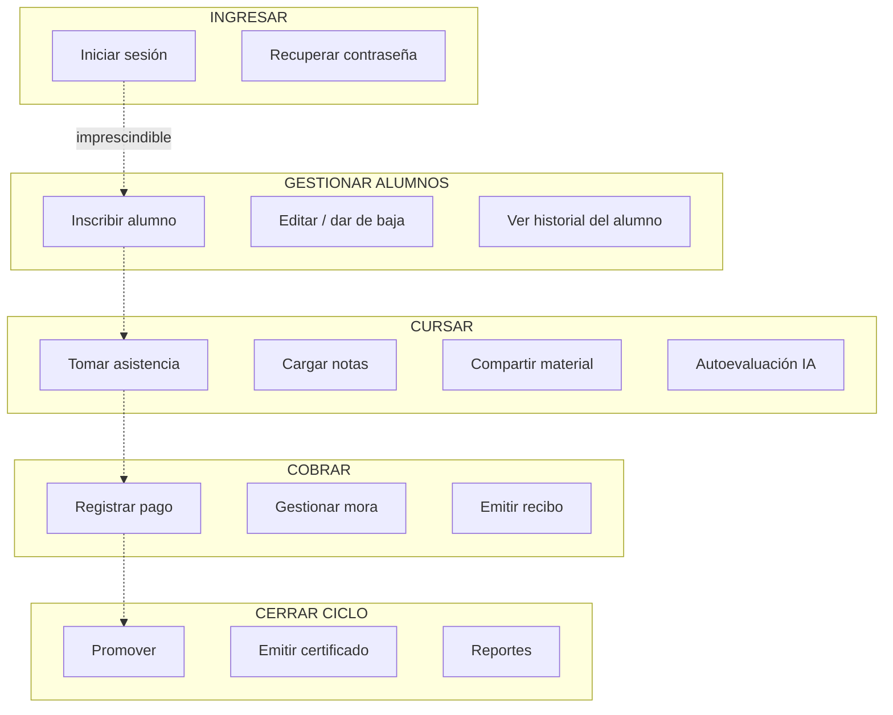

| Actividad | Release 1 (MVP) | Release 2 | Práctica III |
|---|---|---|---|
| Ingresar | Login, invitación | — | — |
| Alumnos | Inscribir, editar, baja | Historial unificado | — |
| Cursar | Asistencia, notas | Material, autoevaluación IA | Chatbot |
| Cobrar | Registrar pago, recibo | Mora automática, anulación | Pago online, ARCA, matrícula |
| Cerrar ciclo | Promover, certificado | Reportes Excel, cierre | — |

## 5.5 Template de User Story

Formato adoptado por el equipo para el backlog en Jira:

```
Como <rol/actor del negocio>
quiero <acción concreta en el sistema>
para <valor/objetivo de negocio>

Criterios de aceptación:
- [ ] <condición verificable 1>
- [ ] <condición verificable 2>
- [ ] pnpm tsc --noEmit sin errores

Origen: <requerimiento / issue / sección del relevamiento>
```

**Ejemplo real** (`SCRUM-233`, creado en este proyecto):

> *Como* administrativa, *quiero* que un alumno pueda quedar en lista de espera cuando el
> curso está lleno, *para* no perder al interesado y avisarle apenas se libere una vacante.
> — con sus criterios de aceptación y origen en el flujograma del relevamiento.

Las 12 historias hijas de `SCRUM-191` siguen este mismo template.

---

## 6. ⚠️ Divergencias a resolver antes de los encuentros

### 6.1 Reglas de negocio que cambiaron entre relevamientos

Las reglas académicas **no las inventó el equipo**: vienen del relevamiento de 2025.
Lo que ocurrió es que la Directora **las cambió** en 2026 y el código todavía tiene las
viejas.

| Regla | [REL-2025] oct/2025 | [REL-2026] may/2026 | Implementado hoy |
|---|---|---|---|
| Asistencia mínima | **80%** | **70%** (`SCRUM-190`) | 80% ❌ desactualizado |
| Escala de notas | **1 a 10** | **0 a 100%** (`SCRUM-188`) | 1–10 ❌ desactualizado |
| Nota mínima | **7/10** | **70/100** | 7,0 ❌ desactualizado |
| Métodos de pago | efectivo y transferencia | + débito y crédito, con descuento y recargo (`SCRUM-180`) | `cash, transfer, card` ❌ incompleto |

**Cómo contarlo:** *"El umbral de 80% viene del relevamiento inicial de octubre 2025.
En la reunión de mayo 2026 la Directora lo bajó a 70% por criterio pedagógico, y está
registrado como `SCRUM-190` pendiente de implementar."* Eso es trazabilidad, y es una
respuesta fuerte. Lo que no se puede es presentar el 80% como vigente.

**Recomendación:** implementar `SCRUM-190` y `SCRUM-188` antes del Encuentro 5. Son dos
constantes, un schema de Zod y una migración `score × 10`.

### 6.2 Reglas relevadas que el sistema nunca implementó

| Regla del negocio [REL-2025] | Estado |
|---|---|
| *"Los alumnos con promedio inferior a 7 pueden recursar el nivel con descuento"* | ❌ sin modelar |
| *"Se permite el cambio de horario o grupo dentro del mismo cuatrimestre"* | ❌ sin modelar (hoy hay que dar de baja e inscribir de nuevo) |
| *"No se aceptan cheques"* | ✅ implícito: el enum no lo incluye |
| Descuento por adelantar el cuatrimestre completo (fidelización) | ❌ `SCRUM-183` pendiente |
| Lista de espera cuando no hay cupo | ❌ sin modelar — está en el flujograma de inscripción |

Ninguna es grave, pero conviene tenerlas listadas: si el docente pregunta *"¿qué pasa
si el curso está lleno?"*, la respuesta hoy es "el sistema lo rechaza", cuando el
negocio real dice "va a lista de espera y se avisa cuando haya cupo".

### 6.3 Divergencias del anteproyecto — para el Encuentro 1

**El Encuentro 1 pide "tecnologías elegidas y justificadas". El stack implementado no
es el del anteproyecto.**

| Componente | Anteproyecto [REL-2025] | Implementado |
|---|---|---|
| Frontend | ASP.NET con C# / React-NextJS (el doc dice ambas) | **Next.js 16 + React 19 + TypeScript** |
| Backend | C# con .NET Framework | **Server Actions de Next.js** |
| Base de datos | Microsoft SQL Server / MySQL (el doc dice ambas) | **PostgreSQL (Supabase)** |
| Hosting | Servidor Windows con IIS | **Vercel** |
| IA | Servicio Python con ML entrenado | **Claude API (`@anthropic-ai/sdk`)** |
| Notificaciones | WhatsApp Business API | **Email (Resend) + notificación interna** |

**La justificación real, y hay que contarla así:** el equipo arrancó con 4 integrantes y
**se fueron dos**. Con la mitad del equipo y el mismo alcance comprometido, sostener el
stack del anteproyecto (C#/.NET + SQL Server + IIS, tres capas separadas, servidor
propio a administrar) no era viable en el tiempo restante. Se eligió un stack más
rápido de desarrollar y más confiable de operar.

Cada decisión se desprende de esa restricción:

| Cambio | Por qué, con medio equipo |
|---|---|
| C#/.NET → **TypeScript en toda la pila** | Un solo lenguaje de frontend a backend: no hay que mantener dos bases de código ni una API REST intermedia. Menos superficie para dos personas |
| IIS/servidor Windows → **Vercel + Supabase** | Elimina por completo la administración de servidor, backups y despliegue que el anteproyecto asumía como trabajo del equipo |
| SQL Server → **PostgreSQL (Supabase)** | Viene con Auth, Storage y RLS integrados. El anteproyecto los daba por construir a mano |
| Python + modelo de ML entrenado → **Claude API** | El modelo del anteproyecto necesitaba un **dataset histórico que el instituto no tiene**, justamente porque no había sistema. Un modelo ya entrenado resuelve el requisito sin ese dato |
| WhatsApp Business API → **email (Resend)** | WhatsApp Business requiere aprobación de Meta y costo por mensaje. El email cumple el mismo requisito de trazabilidad institucional sin dependencia externa ni costo |

**Esta misma restricción explica otras tres cosas** — conviene presentarlas juntas, como
una sola decisión de gestión y no como tres carencias sueltas:

- La **reducción de alcance** del portal de tutores (F-08) y del chatbot SmartEnglish (F-07).
- El **Sprint 8 vencido**: el equipo se redujo a la mitad a mitad del cuatrimestre.
- La priorización de **automatizaciones** por sobre features manuales: con menos gente,
  que el sistema decida solo vale más que una pantalla más.

> **Para el SM:** la pérdida de dos integrantes es un **impedimento del proyecto**, que es
> exactamente lo que un Scrum Master documenta y gestiona. Presentado así, deja de ser una
> debilidad y pasa a ser evidencia de gestión: se detectó, se reajustó el alcance y se
> eligió una tecnología acorde a la nueva capacidad del equipo. Registrarlo en la
> retrospectiva del sprint correspondiente.

**Fuera de alcance en Fase 1 que después entró:** el anteproyecto excluía
explícitamente *"facturación electrónica AFIP"*, y `SCRUM-184` la pide como
obligatoria. Es una ampliación de alcance pedida por el cliente — vale, pero hay que
nombrarla.

**RF-17 (chatbot SmartEnglish) no está implementado.** Va al backlog honesto del
Encuentro 7 como entrega a Práctica III.

### 6.4 Errores internos del documento de relevamiento

Detectados al cruzar sus propias secciones. Conviene corregirlos antes de volver a
presentarlo, porque un docente que lea con atención los encuentra:

| Dónde | Problema |
|---|---|
| Funciones de la Directora (p. 12) | Incluye *"dictado de clases"*, *"carga de notas"* y *"preparación de materiales didácticos"* — son funciones del docente, quedaron pegadas por error |
| Administrativas | El título dice **2 personas**; Recursos Humanos dice **3 administrativas**; el organigrama muestra **3 secretarios** |
| Docentes | El título dice **20 docentes part-time**; Recursos Humanos dice **10 profesores** |
| Flujograma de promoción (p. 40) | La condición dice *"Promedio mayor o igual a **6**"*; todo el resto del documento dice **≥ 7** |
| Historia | Dice *"nacido en 1963"* y la conclusión habla de **65 años de historia** (serían 62 a 2025) |
| Proceso 2 | *"El administrativo pasa lista"*, pero la situación deseada y el RF-04 dicen que la asistencia la toma **el docente** |

El último no es un error de tipeo sino una definición: **conviene aclarar quién toma
asistencia**, porque el sistema hoy lo permite a `profesor`, `administrativo` y
`director`. Si el docente pregunta "¿quién toma lista?", hay que tener una respuesta
sola.

---

## 7. Preguntas abiertas para la próxima reunión con el cliente

1. **Porcentajes exactos** de descuento por efectivo, por transferencia/débito y
   recargo por crédito (`SCRUM-180` los deja configurables pero sin valores).
2. **Monto de matrícula** por curso y si varía según nivel (`SCRUM-181`).
3. ¿La asistencia la toma el **docente** o el **administrativo**? (ver 6.4)
4. ¿Se modela la **lista de espera** cuando el curso llega a 15?
5. ¿Se modela el **recursado con descuento** del alumno no promovido?
6. ¿El alumno suspendido por mora que regulariza vuelve automáticamente a `active` o
   requiere decisión de Dirección?
7. ¿La **contadora externa** necesita acceso propio al sistema, o alcanza con los
   reportes que le pasa la Dirección?


<div style="page-break-before: always;"></div>

# Encuentro 3 — Datos base

**Pregunta eje:** ¿Puedo cargar los datos base del sistema?

Cubre: casos de uso, diccionario de datos, distinción maestras/transaccionales y la
matriz de ABM completo. Cada ABM se justifica por un actor que lo necesita.

---

## 1. Maestras vs. transaccionales

**Entidad maestra:** representa algo que existe de forma estable en el instituto (una
persona, un curso). Se da de alta una vez y se consulta muchas.

**Entidad transaccional:** registra un hecho que ocurre en el tiempo (una asistencia, un
pago). Se generan de a muchas, crecen sin límite y son el insumo de los cálculos.

| Maestras | Transaccionales | De soporte |
|---|---|---|
| `profiles` | `enrollments` | `notifications` |
| `students` | `attendance` | `complaints` |
| `teachers` | `grades` | `documents` |
| `courses` | `payments` | `assessments` / `assessment_attempts` |
| | | `teacher_surveys` / `class_observations` |
| | | `marketing_campaigns` / `inquiries` |
| | | `student_risk_assessments` |
| | | `notification_settings` / `user_notification_preferences` |

---

## 2. Casos de uso

Cada ABM responde a un actor real del negocio. La consigna pide que *cada ABM esté
justificado por un actor que lo necesita* — esta es esa justificación.

### 2.1 Diagrama de casos de uso (núcleo)

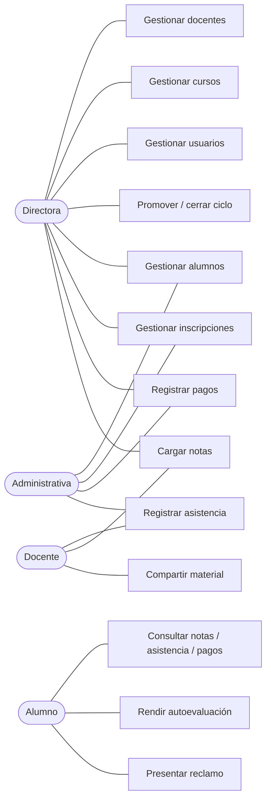

### 2.2 Justificación ABM → actor

| ABM | ¿Qué actor lo necesita y para qué? |
|---|---|
| **Alumnos** | La *administrativa* matricula a cada alumno nuevo y actualiza sus datos. Es el primer paso de todo el flujo del negocio |
| **Docentes** | La *Directora* contrata y da de baja docentes; necesita saber quién puede dictar qué nivel |
| **Cursos** | La *Directora* define la oferta: nivel, horario, cupo, docente a cargo. Es la unidad de venta del instituto |
| **Inscripciones** | La *administrativa* inscribe al alumno en un curso; es lo que habilita asistencia, notas y pagos |
| **Asistencia** | El *docente* (o la administrativa) toma lista cada clase; alimenta el umbral de promoción |
| **Notas** | El *docente* califica cada evaluación; el otro insumo de la promoción |
| **Pagos** | La *administrativa* cobra la cuota y emite el recibo; sostiene el ingreso del instituto |
| **Reclamos** | El *alumno* presenta el reclamo; la *administrativa* o la *Directora* lo resuelve |
| **Usuarios** | La *Directora* crea cuentas de personal (administrativas) y gestiona accesos |

---

## 3. Diccionario de datos

Significado de negocio de cada campo. Tipos según `src/lib/drizzle/schema.ts`.

### 3.1 `profiles` — persona con acceso al sistema (maestra)

| Campo | Tipo | Significado |
|---|---|---|
| `id` | uuid (PK) | Igual al id de `auth.users` de Supabase |
| `email` | text, único | Email de acceso; también identifica al usuario en la invitación |
| `role` | enum | `director` / `administrativo` / `profesor` / `alumno` |
| `full_name` | text | Nombre y apellido |
| `phone` | text, opcional | Teléfono de contacto |
| `avatar_url` | text, opcional | Foto de perfil (Storage) |
| `created_at` / `updated_at` | timestamptz | Auditoría |

### 3.2 `students` — alumno (maestra)

| Campo | Tipo | Significado |
|---|---|---|
| `id` | uuid (PK) | — |
| `profile_id` | uuid (FK→profiles) | La persona detrás del alumno |
| `dni` | text, único | Documento; no puede repetirse |
| `birth_date` | date | Fecha de nacimiento; valida la edad mínima de 6 años |
| `level` | enum, opcional | Nivel de inglés actual |
| `placement_test_score` | integer, opcional | Puntaje del test de nivelación al ingresar |
| `status` | enum | `active` / `inactive` / `suspended` / `graduated` |
| `access_restricted` | boolean | Portal bloqueado por morosidad acumulada (2+ cuotas) |
| `created_at` / `updated_at` | timestamptz | Auditoría |

### 3.3 `teachers` — docente (maestra)

| Campo | Tipo | Significado |
|---|---|---|
| `id` | uuid (PK) | — |
| `profile_id` | uuid (FK→profiles) | La persona detrás del docente |
| `dni` | text, único | Documento |
| `specialization` | text, opcional | Especialización o certificación |

### 3.4 `courses` — curso (maestra)

| Campo | Tipo | Significado |
|---|---|---|
| `id` | uuid (PK) | — |
| `name` | text | Nombre del curso |
| `level` | enum | Nivel que dicta |
| `schedule` | text | Horario legible ("Lun/Mié 18:00–19:30"), generado desde los campos siguientes |
| `class_days` | enum[] | Días de la semana en que se dicta |
| `class_time` | time | Hora de inicio |
| `class_duration_minutes` | integer (def. 90) | Duración de la clase (15–240) |
| `classroom` | text, opcional | Aula asignada (la filial tiene 3) |
| `max_capacity` | integer (def. 15) | Cupo máximo — regla de negocio |
| `teacher_id` | uuid (FK→teachers) | Docente a cargo |
| `diagnostic_frequency` | integer (def. 0) | Cada cuántas clases se dispara una autoevaluación IA; 0 = desactivado |
| `status` | enum | `active` / `inactive` / `completed` |

### 3.5 `enrollments` — inscripción (transaccional principal)

| Campo | Tipo | Significado |
|---|---|---|
| `id` | uuid (PK) | — |
| `student_id` | uuid (FK→students) | Alumno inscripto |
| `course_id` | uuid (FK→courses) | Curso |
| `enrolled_at` | timestamptz | Fecha de inscripción |
| `status` | enum | `active` / `completed` / `withdrawn` |
| `completed_at` | timestamptz, opcional | Fecha de promoción |

> Índice único parcial en `(student_id, course_id) WHERE status = 'active'`: impide dos
> inscripciones activas del mismo alumno al mismo curso.

### 3.6 `attendance` — asistencia (transaccional)

| Campo | Tipo | Significado |
|---|---|---|
| `id` | uuid (PK) | — |
| `enrollment_id` | uuid (FK→enrollments) | A qué inscripción pertenece |
| `class_date` | date | Fecha de la clase |
| `status` | enum | `present` / `absent` / `late` |
| `notes` | text, opcional | Observación |
| `updated_at` | timestamptz, opcional | Cuándo se corrigió (null si es el registro original) |
| `updated_by` | uuid (FK→profiles), opcional | Quién corrigió |

> Constraint único `(enrollment_id, class_date)`: un solo registro por alumno y fecha.

### 3.7 `grades` — calificación (transaccional)

| Campo | Tipo | Significado |
|---|---|---|
| `id` | uuid (PK) | — |
| `enrollment_id` | uuid (FK→enrollments) | A qué inscripción pertenece |
| `evaluation_type` | enum | `parcial` / `final` / `oral` / `homework` / `quiz` |
| `score` | numeric(4,2) | Nota — hoy escala 1,00–10,00 (⚠️ el cliente pidió 0–100, `SCRUM-188`) |
| `evaluated_at` | timestamptz | Fecha de la evaluación |
| `notes` | text, opcional | Observación del docente |

### 3.8 `payments` — pago (transaccional)

| Campo | Tipo | Significado |
|---|---|---|
| `id` | uuid (PK) | — |
| `student_id` | uuid (FK→students) | Alumno |
| `amount` | numeric(10,2) | Monto |
| `due_date` | date | Vencimiento (día 10) |
| `paid_at` | timestamptz, opcional | Fecha de cobro; null si no pagó |
| `method` | enum, opcional | `cash` / `transfer` / `card` |
| `status` | enum | `pending` / `paid` / `overdue` / `suspended` / `cancelled` |
| `receipt_number` | text, único, opcional | Número de recibo |
| `notes` | text, opcional | Observación |
| `overdue_alert_sent_at` | timestamptz, opcional | Cuándo se envió la alerta de mora |
| `cancelled_at` | timestamptz, opcional | Cuándo se anuló |
| `cancelled_by` | uuid (FK→profiles), opcional | Quién anuló |
| `cancellation_reason` | text, opcional | Motivo de la anulación |

### 3.9 Entidades de soporte (resumen)

| Entidad | Campos clave | Significado |
|---|---|---|
| `notifications` | `user_id`, `type`, `title`, `body`, `read`, `batch_id` | Aviso interno a un usuario |
| `complaints` | `user_id`, `type`, `description`, `status`, `resolved_at` | Reclamo formal con estado |
| `documents` | `name`, `file_url`, `mime_type`, `uploaded_by_id` | Material de estudio (Storage) |
| `assessments` | `course_id`, `week_label`, `topic`, `status`, `questions` (JSONB) | Autoevaluación IA por curso |
| `assessment_attempts` | `assessment_id`, `student_id`, `answers`, `score` | Respuesta del alumno (0–100) |
| `teacher_surveys` | `teacher_id`, `course_id`, `rating1..4`, `comment` | Encuesta anónima del docente |
| `class_observations` | `teacher_id`, `observed_by`, `overall_rating`, `observations` | Observación de clase por Dirección |
| `marketing_campaigns` | `name`, `channel`, `budget`, `start_date` | Campaña publicitaria |
| `inquiries` | `name`, `email`, `campaign_id`, `status` | Consulta de un aspirante |
| `student_risk_assessments` | `student_id`, `risk_level`, `signals` (JSONB), `intervened_at` | Score de riesgo de abandono |
| `notification_settings` | `alert_type`, `enabled`, `timing_hours` | Config global de alertas |
| `user_notification_preferences` | `user_id`, `alert_type`, `enabled` | Opt-out por usuario y tipo |

---

## 4. Matriz de ABM

**A** = Alta, **B** = Baja, **M** = Modificación, **L** = Listado. ✅ implementado ·
📝 justificado sin implementar · ⬜ pendiente.

| Entidad | A | B | M | L | Acción principal |
|---|:-:|:-:|:-:|:-:|---|
| Alumnos | ✅ | ✅ | ✅ | ✅ | `createStudentAction` |
| Docentes | ✅ | ✅ | ✅ | ✅ | `createTeacherAction` |
| Cursos | ✅ | ✅ | ✅ | ✅ | `createCourseAction` |
| Inscripciones | ✅ | ✅ | ✅ | ✅ | `createEnrollmentAction` |
| Asistencia | ✅ | ✅ | ✅ | ✅ | `recordAttendanceAction` + `updateAttendanceAction` (¹) |
| Notas | ✅ | ✅ | ✅ | ✅ | `createGradeAction` |
| Pagos | ✅ | ✅ (²) | ✅ (²) | ✅ | `createPaymentAction` + `cancelPaymentAction` |
| Reclamos | ✅ | 📝 (³) | ✅ estado | ✅ | `createComplaintAction` |
| Documentos | ✅ | ✅ | 📝 (⁴) | ✅ | `uploadDocumentAction` |
| Autoevaluaciones | ✅ | ✅ archivar | 📝 (⁵) | ✅ | `generateAssessmentAction` |
| Usuarios | ✅ | ✅ ban | ✅ | ✅ | `createAdministrativoAction` |
| Encuestas docentes | ✅ | 📝 (⁶) | 📝 (⁶) | ✅ | `submitSurveyAction` |
| Observaciones de clase | ✅ | ⬜ | ⬜ | ✅ | `createObservationAction` |
| Campañas marketing | ✅ | ⬜ | ⬜ | ✅ | `createCampaignAction` — ⚠️ módulo en baja (`SCRUM-187`) |
| Consultas (inquiries) | ✅ | ⬜ | ✅ estado | ⬜ (⁷) | `createInquiryAction` |

**Notas de justificación:**

1. **Asistencia** — la corrección (`updateAttendanceAction`) y la baja de sesión
   (`deleteAttendanceSessionAction`) quedan trazadas con usuario y fecha, porque la
   asistencia alimenta la promoción y un cambio no puede ser anónimo.
2. **Pagos** — la "baja" es **anulación, no borrado**: el registro se conserva por
   trazabilidad contable. La modificación solo se permite sobre pagos no cobrados.
3. **Reclamos** — no se borran: se resuelven o cierran (estado). Es la baja lógica
   correcta para el negocio.
4. **Documentos** — un material se reemplaza subiendo la versión nueva y dando de baja la
   anterior; editar el archivo en su lugar rompería el historial del curso.
5. **Autoevaluaciones** — las genera la IA a partir del material; editarlas a mano
   rompería la relación con su fuente. Se archivan y se regeneran.
6. **Encuestas docentes** — son **anónimas**; editarlas o borrarlas selectivamente
   rompería la anonimidad.
7. **Consultas** — sin listado propio; se ven anidadas en el detalle de la campaña.
   Pendiente (hallazgo D-04). Se resuelve o se elimina junto con el módulo de marketing.

---

## 5. Validaciones de integridad

El sistema rechaza operaciones inválidas con mensaje explicativo. (Detalle completo en el
Encuentro 6.) Las principales de la carga base:

| Regla | Mensaje |
|---|---|
| Cupo lleno | "El curso alcanzó el cupo máximo de 15 alumnos" |
| Inscripción duplicada | "El alumno ya está inscripto en este curso" |
| Choque de horario | "El horario se superpone con el curso «…»" |
| Asistencia ya registrada | "La asistencia de esta fecha ya fue registrada" |
| DNI duplicado | "Ya existe un alumno registrado con ese DNI" |
| Nota fuera de rango | "La nota mínima es 1" / "La nota máxima es 10" |
| Edad mínima | "El alumno debe tener al menos 6 años de edad" (⚠️ `SCRUM-186`, pendiente) |

---

## 6. Gestión del sprint (SM)

Requisito del encuentro: Sprint 1 documentado, backlog consistente, dailies registradas
y retrospectiva.

- **Backlog:** épicas por módulo en Jira (proyecto SCRUM), consistentes con los ABM
  demostrados.
- **Dailies y retrospectiva:** ⬜ **a completar por el equipo** — las actas y la retro no
  están en el repositorio; hay que redactarlas (aunque sea retroactivamente).
- **Métricas:** comprometido vs. completado por sprint, a sacar del board.


<div style="page-break-before: always;"></div>

# Encuentro 4 — Identidad del sistema

**Pregunta eje:** ¿Puedo entrar y el sistema sabe quién soy?

Cubre: diagrama de actores del negocio, cada rol como derivación de un actor real,
permisos justificados desde el negocio y el login funcionando.

---

## 1. Diagrama de actores del negocio

Cada actor existe en el instituto **independientemente del sistema**. El rol del sistema
deriva del actor, no al revés.

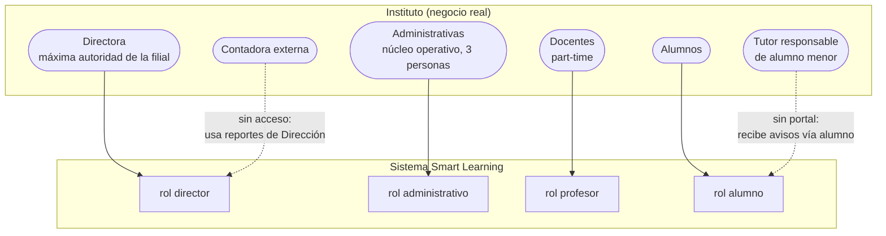

Los actores **Casa Central IICANA** y **ARCA** (fiscal) son sistemas/organismos externos,
sin rol en el sistema.

---

## 2. Cada rol surge de un proceso del negocio

| Rol | Actor del negocio | Qué proceso realiza (por qué existe el rol) |
|---|---|---|
| `director` | Directora | Define la oferta (cursos, precios), contrata docentes, decide promociones y cierre de ciclo, responde por lo fiscal. **Configura las reglas del instituto.** |
| `administrativo` | Administrativas | Inscribe, cobra, toma asistencia, atiende reclamos y consultas. **Ejecuta la operación del día.** |
| `profesor` | Docentes | Dicta, toma lista, califica, comparte material. **Lleva adelante la cursada.** |
| `alumno` | Alumnos | Cursa, consulta sus notas/asistencia/pagos, rinde autoevaluaciones, reclama. **Es el destinatario del servicio.** |

### 2.1 Por qué el rol `administrativo` es de negocio, no técnico

El diseño original tenía tres roles operativos. El `administrativo` nació de una necesidad
del negocio detectada en el relevamiento (`SCRUM-170`): *"El director actualmente
concentra todas las operaciones. Con el crecimiento de la institución, se necesita un
perfil de secretaría que gestione el flujo diario sin riesgo de modificar
configuraciones críticas."*

El corte de permisos **replica la división real de trabajo** de la filial: una Directora
que decide las reglas y tres administrativas que operan el día. No se diseñó desde lo
técnico; se copió la estructura del instituto.

---

## 3. Permisos justificados desde el negocio

El rol `administrativo` **puede** hacer lo que hacen las administrativas y **no puede**
tocar lo que decide la Directora. La regla no es técnica: es "¿quién hace esto en el
instituto real?".

| Sección | ¿`administrativo` puede? | Justificación de negocio |
|---|:-:|---|
| Alumnos | ✅ | Las administrativas matriculan y actualizan datos |
| Inscripciones | ✅ | Inscriben al alumno en el curso |
| Pagos | ✅ | Cobran la cuota y emiten recibo |
| Asistencia | ✅ | Cargan la asistencia diaria |
| Reclamos | ✅ | Reciben y gestionan reclamos |
| Notificaciones | ✅ | Envían avisos a alumnos y tutores |
| Notas | ✅ solo lectura | Ven las notas para atención al público; no las cargan |
| **Usuarios** | ❌ | Crear cuentas de sistema es decisión de la Directora |
| **Docentes** | ❌ | Contratar y dar de baja docentes es de la Directora |
| **Cursos** | ❌ | Definir la oferta (precios, cupos, horarios) es estratégico |
| **Evaluación docente** | ❌ | La Directora evalúa a su equipo |
| **Autoevaluaciones IA** | ❌ | Configuración académica de la Directora |
| **Cierre de ciclo / promociones** | ❌ | Decisión académica de la Directora |
| **Marketing** | ❌ | Planificación estratégica de la Directora |

### 3.1 Cómo se hace cumplir técnicamente

Dos capas, para que el permiso no dependa de que la UI esconda un botón:

1. **`proxy.ts`** (Edge, antes de cada request): valida la sesión con
   `supabase.auth.getUser()` y, si el rol es `administrativo`, bloquea las rutas
   exclusivas de dirección redirigiendo a `/403`.

   ```
   ADMIN_ONLY_ROUTES = users, teachers, courses, teacher-evaluations,
                       assessments, year-end, marketing, promotions,
                       settings, profile
   ```

2. **`requireRole([...])`** al inicio de **cada** Server Action: aunque alguien llame la
   mutación directamente, la acción rechaza el rol no autorizado. (Mapa completo en el
   Encuentro 5, tabla de trazabilidad.)

---

## 4. Login funcionando

- **Autenticación:** Supabase Auth. La contraseña nunca viaja ni se guarda en claro.
- **Flujo de invitación:** la Directora/administrativa crea el usuario → el sistema
  genera un link `/invite/[email]` → Resend envía el email → el usuario establece su
  contraseña en `/update-password`.
- **Dos vistas distintas mínimas:** el sistema tiene **cuatro** landings, una por rol
  (`/director`, `/administrativo`, `/profesor`, `/alumno`), cada una mostrando solo lo
  que ese rol puede ver. Supera el requisito de "mínimo dos roles con vistas distintas".
- **Landing según rol:** el `layout.tsx` del dashboard lee el perfil y arma el sidebar
  con los ítems permitidos.

### 4.1 Los ABM del encuentro anterior siguen funcionando

Verificable con `pnpm tsc --noEmit` (sin errores) y los 159 tests unitarios en verde. La
carga base del Encuentro 3 no se rompió al sumar la capa de identidad.

---

## 5. Gestión (SM)

- **Roles validados con el cliente:** `SCRUM-170` (creación del rol administrativo) y
  `SCRUM-191` (relevamiento con la Directora) son la evidencia de que el corte de
  permisos se validó con el negocio, no se inventó.
- **Backlog actualizado y priorizado:** ver [hallazgos.md](hallazgos.md) para el estado
  real por prioridad.


<div style="page-break-before: always;"></div>

# Encuentro 5 — Lógica de negocio

**Pregunta eje:** ¿El sistema hace lo que dice que hace?

Cubre: reglas de negocio en lenguaje del cliente, BPMN del proceso principal, trazabilidad
regla → requerimiento, y la demostración de que el sistema **decide**, no solo guarda.

---

## 1. Reglas de negocio en lenguaje del cliente

Escritas como las diría la Directora, no como están en el código.

| # | Regla (lenguaje del cliente) | Dónde vive |
|---|---|---|
| R1 | "Un curso no puede tener más de 15 alumnos." | `courses.max_capacity` + `validateAndCreateEnrollment` |
| R2 | "Un alumno no se puede inscribir dos veces al mismo curso." | índice único parcial `enrollments` |
| R3 | "No puedo inscribir a alguien en dos cursos que se pisan de horario." | `schedulesOverlap` en enrollments |
| R4 | "Para promocionar hay que tener 80% de asistencia y 7 de promedio." | `promotions.service.ts:5-6` (⚠️ cliente pidió 70% y 70/100) |
| R5 | "La cuota vence el día 10." | `payments.due_date` |
| R6 | "A los 15 días de mora aviso; a los 30 lo suspendo." | `payments.service.ts` |
| R7 | "Si debe 2 cuotas, le corto el acceso al portal." | `automations/actions.ts` |
| R8 | "Si un alumno falta 2 veces seguidas, quiero enterarme." | `attendance/actions.ts` |
| R9 | "Quiero detectar antes a los que están por abandonar." | `risk-detection.service.ts` |
| R10 | "El alumno menor de 6 años no se inscribe." | `students/schemas.ts` (⚠️ `SCRUM-186` pendiente) |

---

## 2. BPMN — proceso central (inscripción → cursada → promoción)

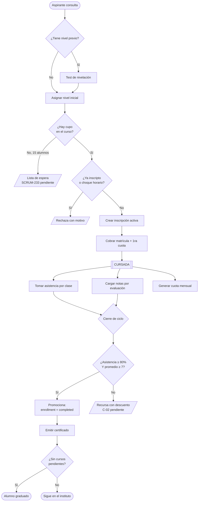

Las cajas punteadas son partes del proceso del negocio que el sistema aún no modela
(lista de espera, recursado) — ver [hallazgos.md](hallazgos.md) C-01 y C-02.

### 2.1 Proceso de cobranza y mora

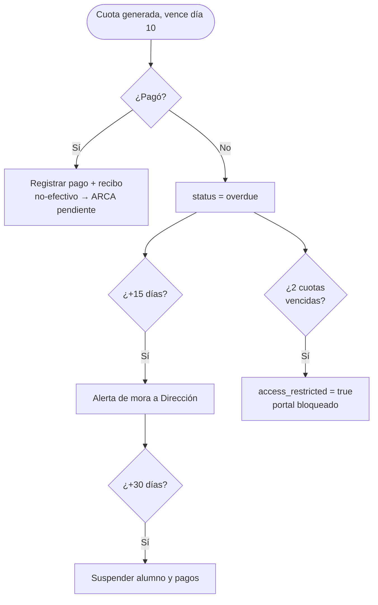

---

## 3. El sistema DECIDE, no solo guarda

La pregunta clave del encuentro es *"¿el sistema decide o solo guarda?"*. Estas son las 9
decisiones automáticas que el sistema toma sin que nadie se lo pida.

| # | Decisión automática | Regla | Archivo |
|---|---|---|---|
| 1 | Promociona o no a cada alumno | asistencia ≥ 80% **y** nota ≥ 7 | `promotions.service.ts:85` |
| 2 | Gradúa al alumno sin cursos pendientes | al consolidar el ciclo | `year-end.service.ts:170` |
| 3 | Marca la cuota como vencida | pendiente + vencida | `payments.service.ts:132` |
| 4 | Alerta a Dirección por mora | +15 días sin pagar | `payments.service.ts:151` |
| 5 | Suspende alumno y pagos | +30 días sin pagar | `payments.service.ts:184` |
| 6 | Restringe el acceso al portal | 2+ cuotas vencidas | `automations/actions.ts:78` |
| 7 | **Calcula el riesgo de abandono** | cruza mora + asistencia <70% + rendimiento <60% → none/low/medium/high | `risk-detection.service.ts:21` |
| 8 | Alerta por 2 ausencias consecutivas | 2 faltas seguidas | `attendance/actions.ts:36` |
| 9 | Genera una autoevaluación con IA | cada N clases del curso | `auto-assessment.service.ts:41` |

**La demostración estrella (decisión #7):** la detección de riesgo de abandono cruza tres
fuentes de datos independientes —pagos, asistencia y rendimiento— y emite un juicio
(nivel de riesgo) que **ningún humano pidió**. Eso es exactamente lo que el relevamiento
identificó como el dolor a resolver: *"Alumnos que abandonan sin que la institución lo
detecte a tiempo para intervenir."* El sistema no espera a que pregunten: avisa.

### 3.1 Procesamiento automático programado (5 crons diarios)

| Cron | Hora (UTC) | Qué hace |
|---|---|---|
| `class-reminder` | 23:00 | Recordatorio de clase de mañana, respetando opt-outs |
| `payment-reminder` | 12:00 | Aviso de cuota que vence en 3 días |
| `overdue-alert` | 11:00 | Alerta de cuotas ya vencidas |
| `daily-report` | 10:00 | Reporte diario por email a Dirección |
| `risk-detection` | 09:00 | Recalcula el riesgo de abandono de cada alumno activo |

---

## 4. Trazabilidad: cada regla implementada tiene origen en un requerimiento real

| Regla | Origen documentado |
|---|---|
| Cupo de 15 | `[REL-2025]` Proceso 1, control "cupo máximo por curso (15 alumnos)" |
| Vencimiento día 10 | `[REL-2025]` Políticas de Pago |
| Mora 15/30 días | `[REL-2025]` Políticas de Pago (recordatorio 15, baja 30) |
| Promoción por asistencia y nota | `[REL-2025]` Proceso 7, controles |
| 2 ausencias → aviso | `[REL-2025]` Proceso 2, "alerta por 2 ausencias consecutivas" |
| Detección de riesgo | `[REL-2025]` diagnóstico: "dificultad para detectar alumnos en riesgo" → RF-16 |
| Autoevaluación IA | Anteproyecto, módulo de IA |
| Rol administrativo y su corte de permisos | `SCRUM-170` |
| Umbral 70% / escala 0–100 | `[REL-2026]` `SCRUM-190`, `SCRUM-188` (pendientes) |

`[REL-2025]` = relevamiento institucional Práctica I · `[REL-2026]` = relevamiento con la
Directora (`SCRUM-191`).

### 4.1 Mapa acción → rol (control de acceso por Server Action)

Cada mutación exige rol al entrar. Extracto (mapa completo en el código):

| Módulo | Acción | Roles habilitados |
|---|---|---|
| Alumnos | crear/editar/baja | director, administrativo |
| Pagos | crear/cobrar/anular | director, administrativo |
| Asistencia | registrar/corregir | director, administrativo, profesor |
| Notas | crear/editar/baja | director, profesor |
| Cursos | crear/editar/baja | **director** |
| Docentes | crear/editar/baja | **director** |
| Usuarios | crear/ban/invitar | **director** |
| Promoción / cierre de ciclo | ejecutar | **director** |
| Autoevaluación | rendir | alumno |
| Encuesta docente | responder | alumno |

---

## 5. Gestión (SM) — la tensión con el cliente

Requisito del encuentro: *"Si el cliente no apareció: SM documenta el bloqueo, la
decisión tomada y el impacto en el backlog."*

Dos hechos de gestión a presentar honestamente:

1. **El cliente cambió reglas ya implementadas** (umbral de asistencia, escala de notas)
   en el relevamiento de mayo. El equipo las registró como `SCRUM-190`/`SCRUM-188` y las
   dejó pendientes de implementar. **Impacto en el backlog:** dos historias nuevas
   priorizadas para el próximo sprint.

2. **El equipo se redujo de 4 a 2 integrantes.** Es el impedimento central del proyecto.
   Se gestionó recortando alcance (portal de tutores, chatbot) y eligiendo un stack más
   productivo. Registrarlo en la retrospectiva del sprint correspondiente.

⬜ **A completar por el equipo:** actas de daily y métricas del sprint (comprometido vs.
completado), que no están en el repositorio.


<div style="page-break-before: always;"></div>

# Encuentro 6 — Casos borde

**Pregunta eje:** ¿Qué pasa cuando algo sale mal?

Cubre: diagramas de estado de las entidades principales, casos borde derivados de esos
estados, lista de excepciones que el sistema rechaza y por qué.

> Reemplaza al borrador `encuentro-6-casos-borde.docx` (previo a las correcciones de
> asistencia y pagos de julio 2026).

---

## 1. Diagramas de estado

Los casos borde se derivan de los estados, no se inventan. Estos son los cinco diagramas
de las entidades con ciclo de vida.

### 1.1 `student_status` — alumno

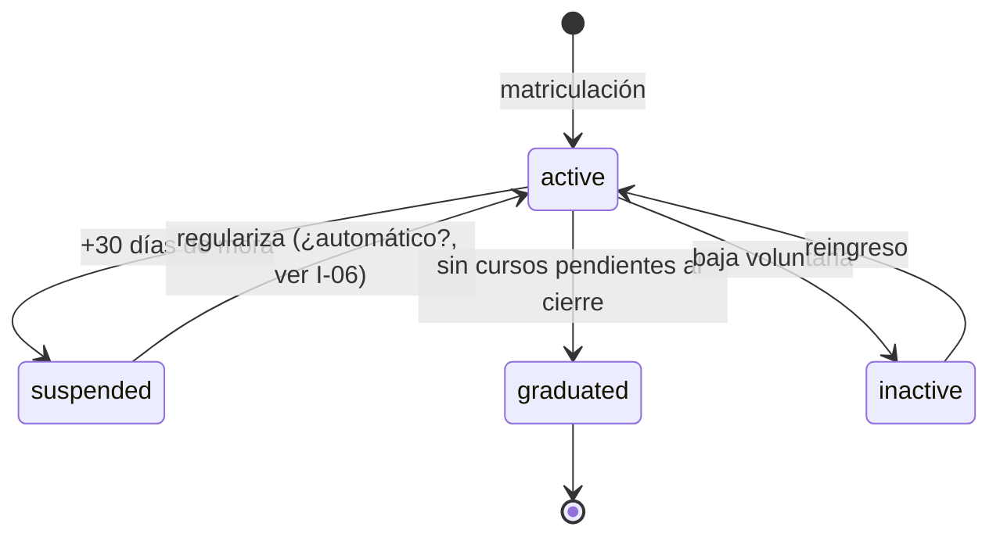

### 1.2 `enrollment_status` — inscripción

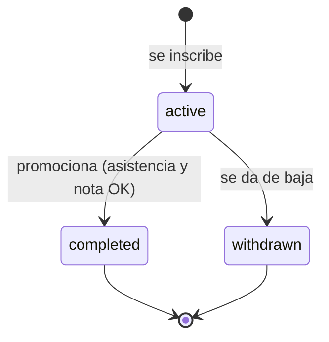

### 1.3 `payment_status` — pago

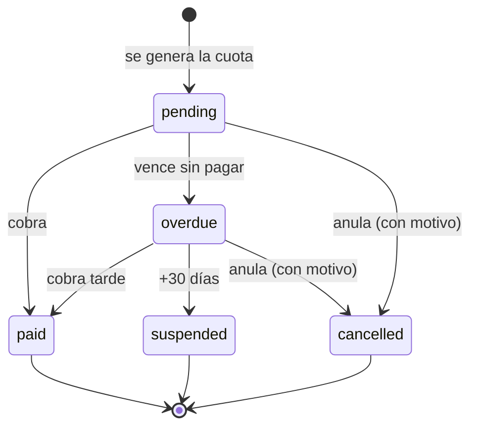

### 1.4 `complaint_status` — reclamo

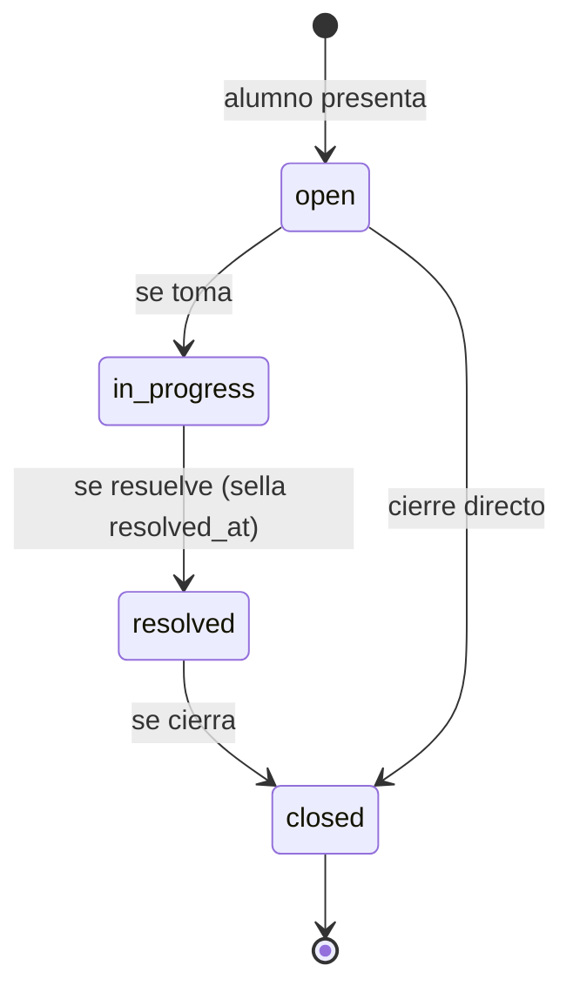

### 1.5 `assessment_status` — autoevaluación

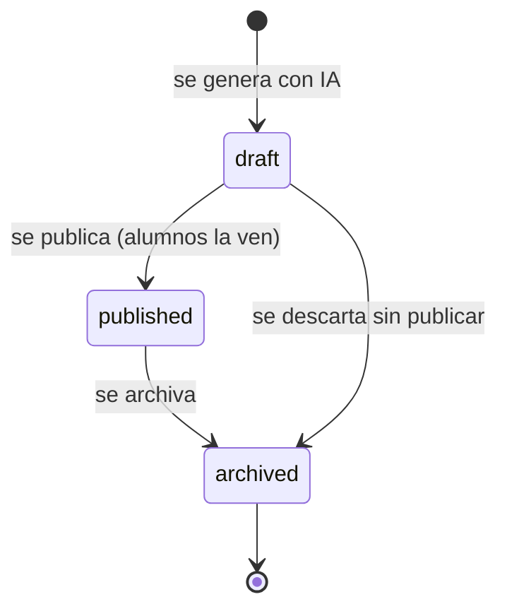

---

## 2. Casos borde derivados de los estados

| # | Situación borde | Qué hace el sistema |
|---|---|---|
| CB1 | Corregir una asistencia ya cargada | Permite corregir (`updateAttendanceAction`) y deja traza de quién y cuándo |
| CB2 | Clase cargada en el curso equivocado | Permite eliminar la sesión completa (`deleteAttendanceSessionAction`) |
| CB3 | Pago cargado con monto equivocado | Editable solo si no está cobrado; si ya se cobró, se anula y se registra de nuevo |
| CB4 | Anular un pago | Cambia a `cancelled` con motivo obligatorio; no se borra (trazabilidad contable) |
| CB5 | Doble submit del formulario de asistencia | `onConflictDoNothing` + constraint único evitan duplicados |
| CB6 | Dos inscripciones concurrentes al último cupo | `SELECT FOR UPDATE` serializa; el índice único es la red final |
| CB7 | Regularizar una cuota vencida | `overdue` → `paid`; el alumno suspendido debería reactivarse (⚠️ ver I-06) |
| CB8 | Alumno sin datos de asistencia al cierre | Se clasifica como `no_data`, no se promueve por error |
| CB9 | Curso lleno (15 alumnos) | Hoy rechaza; el negocio pide lista de espera (⚠️ `SCRUM-233`) |

---

## 3. Lista de excepciones — qué rechaza el sistema y por qué

Cada validación devuelve un mensaje que **explica** el rechazo (requisito del encuentro:
"el sistema explica por qué rechaza"). En español, orientado al usuario.

### 3.1 Inscripciones

| Rechaza | Mensaje | Por qué |
|---|---|---|
| Curso inexistente | "Curso no encontrado" | Integridad referencial |
| Duplicado activo | "El alumno ya está inscripto en este curso" | Regla R2 |
| Cupo lleno | "El curso alcanzó el cupo máximo de 15 alumnos" | Regla R1 |
| Choque de horario | "El horario se superpone con el curso «…»" | Regla R3 |

### 3.2 Asistencia y notas

| Rechaza | Mensaje |
|---|---|
| Asistencia duplicada por fecha | "La asistencia de esta fecha ya fue registrada" |
| Nota fuera de rango | "La nota mínima es 1" / "La nota máxima es 10" |

### 3.3 Pagos

| Rechaza | Mensaje |
|---|---|
| Monto ≤ 0 | "El monto debe ser mayor a 0" |
| Recibo duplicado | "Ya existe un pago con ese número de recibo" |
| Fecha inválida | "Ingresá una fecha válida" |
| Anulación sin motivo | "Explicá el motivo de la anulación (mínimo 10 caracteres)" |
| Editar pago ya cobrado | "Solo se puede editar un pago pendiente o vencido. Anulá el pago y registrá uno nuevo." |

### 3.4 Alumnos y usuarios

| Rechaza | Mensaje |
|---|---|
| DNI duplicado | "Ya existe un alumno registrado con ese DNI" |
| Email duplicado | "Ya existe un usuario con ese email" |
| Edad < 6 años | "El alumno debe tener al menos 6 años de edad" (⚠️ `SCRUM-186` pendiente) |

### 3.5 Documentos y reclamos

| Rechaza | Mensaje |
|---|---|
| Archivo > 10 MB | "El archivo no puede superar los 10 MB" |
| Formato no permitido | "Formato no permitido. Usá PDF, Word, imágenes o texto plano." |
| Reclamo muy corto | descripción mín. 20 caracteres |
| Evaluación docente duplicada | "Ya enviaste tu evaluación para este curso" |

---

## 4. Validaciones justificadas desde reglas del negocio

Ninguna validación es arbitraria; todas derivan de una regla del instituto:

- El **cupo de 15** viene de la capacidad real de las aulas.
- El **DNI único** evita el problema relevado de "duplicación de registros".
- La **edad mínima de 6 años** es la política de ingreso del instituto.
- La **anulación con motivo** (no borrado) responde a la necesidad de la contadora de
  auditar los movimientos.
- El **constraint de asistencia única** ataca directamente el problema relevado de
  "bloqueo de carga duplicada".

---

## 5. Concurrencia — el caso borde más técnico

Dos hallazgos resueltos este sprint, buen material para "Dev responde ante pedidos del
docente intentando romper el sistema":

- **Cupo e inscripción bajo concurrencia** (`SCRUM-231`): dos requests simultáneos podían
  burlar el cupo de 15 leyendo el mismo total antes de insertar. Resuelto con
  `SELECT ... FOR UPDATE` sobre el curso dentro de una transacción, más un índice único
  parcial como red de seguridad.
- **Asistencia duplicada** (`SCRUM-232`): constraint único `(enrollment_id, class_date)`
  + `onConflictDoNothing`, para que un doble submit no genere registros duplicados.

---

## 6. Gestión (SM)

- **Casos borde validados o justificados por el equipo:** los de la sección 2 están
  cubiertos; CB7 y CB9 quedan como decisiones abiertas para el cliente (I-06, `SCRUM-233`).
- **Retrospectiva con decisiones concretas:** ⬜ a redactar — incluir la decisión de
  resolver concurrencia con constraints de BD en vez de solo validación de aplicación.


<div style="page-break-before: always;"></div>

# Encuentro 7 — Entregables del sistema

**Pregunta eje:** ¿El sistema produce algo que el cliente puede llevarse?

Cubre: especificación de cada reporte (quién lo pide, para qué decisión, con qué datos),
trazabilidad reporte → requerimiento, estado honesto del backlog y plan de entrega a
Práctica III.

---

## 1. Las salidas del sistema

El sistema transforma datos en información útil. Seis salidas concretas:

| Salida | Formato | Quién la genera |
|---|---|---|
| Reporte de asistencia | Excel (.xlsx) | Dirección |
| Reporte de notas | Excel (.xlsx) | Dirección |
| Reporte de pagos | Excel (.xlsx) | Dirección |
| Certificado de promoción | Imprimible (web → PDF) | Dirección / Alumno |
| Recibo de pago | Imprimible (web → PDF) | Alumno |
| Reporte diario | Email automático | Dirección (cron 10:00 UTC) |

---

## 2. Ficha de cada reporte

### 2.1 Reporte de asistencia

- **Quién lo pide:** la Directora.
- **Para qué decisión:** determinar quién cumple el mínimo de asistencia para promover y
  detectar cursos con ausentismo alto.
- **Con qué datos:** Alumno, DNI, Curso, Total de clases, Presentes, Ausentes, Tardanzas,
  % de asistencia.
- **Transforma, no solo lista:** el % de asistencia es **calculado** `(presentes + tardes)
  / total`, no un dato almacenado.
- **Ruta:** `GET /api/reports/attendance` → `reporte-asistencia.xlsx`. Solo rol `director`.

### 2.2 Reporte de notas

- **Quién lo pide:** la Directora.
- **Para qué decisión:** ver el rendimiento por alumno y curso, insumo de la promoción y
  de la evaluación docente.
- **Con qué datos:** Alumno, DNI, Curso, Tipo de evaluación, Nota, Fecha, Aprobado.
- **Ruta:** `GET /api/reports/grades` → `reporte-notas.xlsx`. Solo rol `director`.

### 2.3 Reporte de pagos

- **Quién lo pide:** la Directora (y la contadora externa a través de ella).
- **Para qué decisión:** controlar la recaudación, la morosidad y conciliar con la
  contadora.
- **Con qué datos:** Alumno, DNI, Monto, Vencimiento, Fecha de pago, Método, Estado, Nº de
  recibo.
- **Ruta:** `GET /api/reports/payments` → `reporte-pagos.xlsx`. Solo rol `director`.

> ⚠️ **Decisión abierta (I-08):** los tres reportes son **solo `director`**. La contadora
> y las administrativas no acceden. Hay que decidir: o se habilita el de pagos al rol
> `administrativo`, o se justifica la exclusión desde el negocio. El relevamiento pide
> además diferenciar totales diarios por método de pago (`SCRUM-185`) — pendiente.

### 2.4 Certificado de promoción

- **Quién lo pide:** el alumno que promocionó; lo emite la Directora.
- **Para qué:** constancia oficial de que completó el nivel.
- **Datos:** solo se genera para inscripciones en estado `completed`.
- **Ruta:** `/director/promotions/[enrollmentId]/certificate` (imprimible).

### 2.5 Recibo de pago

- **Quién lo pide:** el alumno, como comprobante.
- **Para qué:** constancia del pago; reemplaza el recibo manuscrito del proceso anterior.
- **Datos:** solo para pagos en estado `paid`.
- **Ruta:** `/director/payments/[id]/receipt` (imprimible).

### 2.6 Reporte diario por email

- **Quién lo recibe:** la Directora, automáticamente.
- **Para qué decisión:** empezar el día sabiendo qué pasó ayer sin pedir nada.
- **Datos:** pagos del día por método, alumnos con asistencia baja, nuevos alumnos.
- **Cómo:** cron `daily-report` a las 10:00 UTC.

---

## 3. Trazabilidad: cada reporte responde a un requerimiento real

| Reporte | Requerimiento de origen |
|---|---|
| Asistencia | `[REL-2025]` Proceso 10 "reportes de cumplimiento por alumno" |
| Notas | `[REL-2025]` "dificultad para generar reportes de rendimiento por curso o docente" |
| Pagos | `[REL-2025]` Proceso 4 "reporte de morosidad mensual"; RF-12 |
| Certificado | `[REL-2025]` Proceso 7 "emisión de certificado"; problema: "falta de automatización en la generación de certificados" |
| Recibo | `[REL-2025]` problema: "recibos manuales sin trazabilidad digital" |
| Reporte diario | `[REL-2025]` diagnóstico: "limitada disponibilidad de información en tiempo real para la dirección" |

`[REL-2025]` = relevamiento institucional Práctica I.

---

## 4. Estado honesto del backlog

Requisito del encuentro: *"SM presenta el estado del proyecto con honestidad sobre qué
queda para Práctica III."*

### 4.1 Hecho ✅

Sistema funcional en producción: auth, 4 portales, ABM completo de las entidades núcleo,
asistencia con corrección trazable, pagos con anulación auditada, 9 automatizaciones,
evaluación docente, autoevaluaciones IA, material por curso, promociones, cierre de ciclo,
certificados y recibos imprimibles, 3 reportes Excel, reporte diario automático.

### 4.2 Falta para cerrar bien la presentación 🔴

- Actualizar umbrales de negocio: 70% asistencia y escala 0–100 (`SCRUM-190`, `SCRUM-188`).
- Los 9 documentos de análisis FN (7 ya escritos: encuentros 1–7).
- Evidencia de gestión: actas de daily, retrospectivas, métricas por sprint.

### 4.3 Entra a Práctica III 📦

| Tema | Issue |
|---|---|
| Rediseño de pagos: matrícula, cuota por curso, descuentos, pago online, adelanto | `SCRUM-178` y sus hijas |
| Facturación electrónica ARCA | `SCRUM-184` |
| Lista de espera por cupo lleno | `SCRUM-233` |
| Chatbot de práctica de inglés "SmartEnglish" (RF-17) | — |
| Portal de tutores (RF-14) | — |
| CI/CD con GitHub Actions | `SCRUM-150` |
| Acceso propio de la contadora externa | — |
| Recursar con descuento; cambio de grupo en el cuatrimestre | C-02, C-03 |

---

## 5. Plan de entrega a Práctica III

1. **Congelar el alcance de Práctica II:** cerrar los pendientes 🔴 y etiquetar en Jira
   todo lo que pasa a la siguiente materia como `practica-iii`.
2. **Priorizar por valor de negocio:** el rediseño de pagos (`SCRUM-178`) es el más pedido
   por la Directora y el de mayor impacto en la recaudación; encabeza el backlog de III.
3. **Habilitar CI/CD** (`SCRUM-150`) al inicio de III: con el sistema ya en producción,
   automatizar typecheck, lint y E2E baja el riesgo de regresiones.
4. **Cerrar las decisiones abiertas con el cliente** (sección I de `hallazgos.md`) antes de
   estimar: porcentajes de descuento, monto de matrícula, quién toma asistencia.

---

## 6. Todo lo anterior sigue funcionando en conjunto

⬜ **Smoke test integral pendiente** (hallazgo A-05): recorrer los 4 portales de punta a
punta antes de la presentación —inscribir, tomar asistencia, cargar nota, cobrar, promover,
generar cada reporte— para demostrar que los módulos funcionan integrados, no solo por
separado. `pnpm tsc --noEmit` y los 159 tests unitarios ya pasan en verde.


<div style="page-break-before: always;"></div>

# Anexo A — Métricas de sprints


Datos extraídos del board de Jira el **21/07/2026**.

> **Nota metodológica — leer antes de usar.** Estos números salen de la **membresía
> actual** de cada sprint, donde **todos los issues figuran hoy como "Finalizado"**. Jira
> devuelve el estado actual, no el que el issue tenía al momento de cerrar el sprint. Por
> eso:
>
> - El **throughput** (issues entregados por sprint) es confiable.
> - El **"comprometido vs. completado al cierre"** exacto **no se puede reconstruir** desde
>   acá: hay issues que se movieron de un sprint al siguiente (carryover, ver §3). La
>   fuente autoritativa de esa métrica es el **Sprint Report nativo de Jira**
>   (Board → Reports → Sprint Report), que sí guarda la foto al cierre. Para la
>   presentación, conviene sacar captura de ese report por cada sprint.
> - **Story points cargados el 21/07/2026** en los ~150 issues de los sprints 1–8 (§4).
>   Ojo: esto **no** rellena el Velocity Report nativo de los sprints cerrados (§4.1) —
>   ese report usa fotos históricas congeladas al cierre y muestra Completed = 0. La
>   métrica de velocidad válida es la **reconstruida** de §4.1–4.2, no la del report nativo.

---

## 1. Throughput por sprint (issues entregados)

| Sprint | Fechas | Issues | Historias | Tareas | Bugs | Estado final |
|---|---|---:|---:|---:|---:|---|
| 0 | 19/01 – 02/02 | 0 (planificación) | — | — | — | Cerrado |
| Sprint | Fechas | Issues | Historias | Bugs | Tareas | Story Points |
|---|---|---:|---:|---:|---:|---:|
| 0 | 19/01 – 02/02 | 0 | 0 | 0 | 0 | 0 |
| 1 | 02/02 – 16/02 | 13 | 6 | 6 | 1 | 32 |
| 2 | 16/02 – 02/03 | 39 | 30 | 1 | 8 | 108 |
| 3 | 02/03 – 16/03 | 30 | 20 | 6 | 4 | 80 |
| 4 | 16/03 – 30/03 | 15 | 5 | 9 | 1 | 35 |
| 5 | 04/05 – 11/05 | 10 | 7 | 2 | 1 | 27 |
| 6 | 11/05 – 25/05 | 33 | 15 | 12 | 6 | 81 |
| 7 | 27/05 – 11/06 | 31 | 7 | 8 | 16 | 69 |
| 8 | 11/06 – 25/06 | 17 | 14 | 0 | 3 | 48 |
| **Total** | | **188** | **104** | **44** | **40** | **480** |

Números tomados de la consulta en vivo al board (21/07/2026); coinciden con el Reporte de
Sprints del proyecto.

**Lectura para el coloquio:** la tasa de finalización es **100% en todos los sprints
ejecutados** — todo lo que entró a un sprint terminó cerrándose. Ese es el dato fuerte de
gestión.

---

## 2. Gráfico de entrega

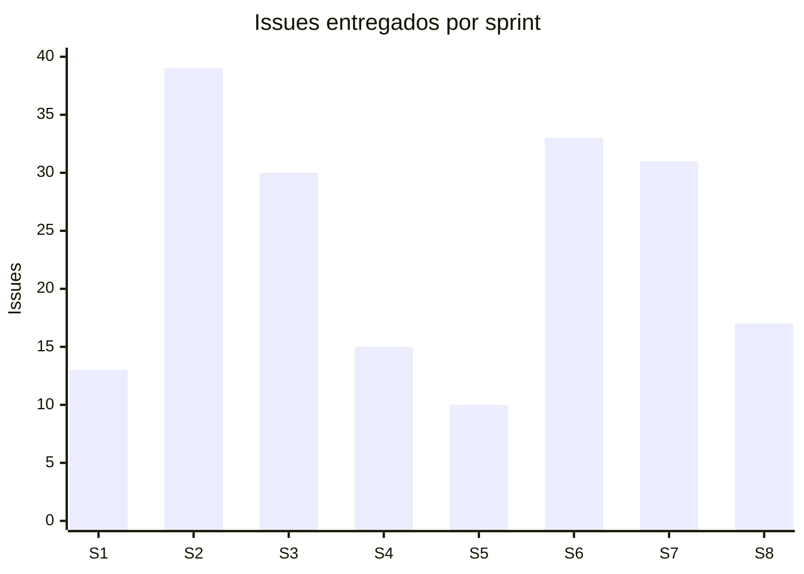

Se ve el pico de los sprints 2–3 (construcción del núcleo) y una entrega sostenida hacia
el final aun con el equipo reducido.

---

## 3. Carryover — issues que se movieron entre sprints

Detectado al cruzar la membresía: varios issues aparecen en más de un sprint, señal de que
no se completaron en el sprint donde se comprometieron y se arrastraron al siguiente.

| Issues arrastrados | De → A |
|---|---|
| SCRUM-102 a 107, 123, 124, 134, 135 | Sprint 5 → Sprint 6 |
| SCRUM-129, 130, 131, 137 | Sprint 6 → Sprint 7 |

**Esto es normal en Scrum** y conviene presentarlo como tal: no todo lo comprometido entra
en un sprint, y el equipo repriorizó arrastrando al siguiente. Es material honesto para la
retrospectiva, no algo que ocultar.

> El Sprint 5 es el más chico (10 issues) y **todos** se arrastraron al 6. Coincide con el
> período de reducción del equipo — buen dato para la retro del Sprint 8.

---

## 4. Story points — cargados retroactivamente

El 21/07/2026 se cargaron story points en **todos** los issues de los sprints 1–8
(~150 issues), con una escala simple y uniforme para que la velocidad sea comparable
entre sprints:

| Tipo de issue | Puntos |
|---|---|
| Historia (Story) | 3 |
| Tarea (Task) | 2 |
| Bug | 2 |

Verificado: **0 issues sin puntos** en los 8 sprints tras la carga.

**Velocidad por sprint** (suma de puntos, comparable entre sprints):

| Sprint | Puntos | Issues |
|---|---:|---:|
| 1 | 32 | 13 |
| 2 | 108 | 39 |
| 3 | 80 | 30 |
| 4 | 35 | 15 |
| 5 | 27 | 10 |
| 6 | 81 | 33 |
| 7 | 69 | 31 |
| 8 | 48 | 17 |
| **Total** | **480** | **188** |

> **Salvedad honesta sobre esta escala.** Los puntos se asignaron por **tipo de issue**,
> no por complejidad real estimada en su momento (el equipo no estimó durante los sprints).
> Es una reconstrucción razonable y consistente, pero la velocidad resultante es casi
> proporcional al conteo de issues. Si en el coloquio preguntan por el criterio de
> estimación, hay que decir esto: se estimó retroactivamente con una escala por tipo,
> porque no se había hecho story-point planning en su momento. Es la deuda de gestión que
> el equipo reconoce en la [retrospectiva del Sprint 8](retrospectiva-sprint-8.md).

### 4.1 ⚠️ Por qué el Velocity Report nativo de Jira NO sirve para estos sprints

Cargar los story points **no repara** el Velocity Report de los sprints ya cerrados. El
report usa dos fotos históricas, tomadas en el momento del sprint:

- **Commitment:** puntos de los issues presentes al **iniciar** el sprint.
- **Completed:** puntos de los issues terminados al **cerrar** el sprint.

Como los puntos se cargaron **después** de que los 8 sprints ya estaban cerrados, esas
fotos quedaron congeladas: el report muestra **Completed = 0 en los 8 sprints** (y
Commitment solo en los más recientes). **Esto no se puede corregir sin reabrir y
re-cerrar los sprints, lo que falsearía las fechas de cierre** — y eso no se hace.

**Consecuencia práctica:**

- Para los sprints **1 a 8** (cerrados): se usa la **tabla de velocidad reconstruida** de
  arriba y el gráfico de §4.2 como métrica del proyecto. **No** se presenta el Velocity
  Report nativo, porque quedó vacío por la razón explicada.
- Del Sprint **9 en adelante:** si se estima **antes** de arrancar cada sprint, el Velocity
  Report nativo se llena solo y pasa a ser la fuente válida.

### 4.2 Gráfico de velocidad reconstruida

Como los 8 sprints cerraron al 100%, la velocidad completada coincide con la comprometida.

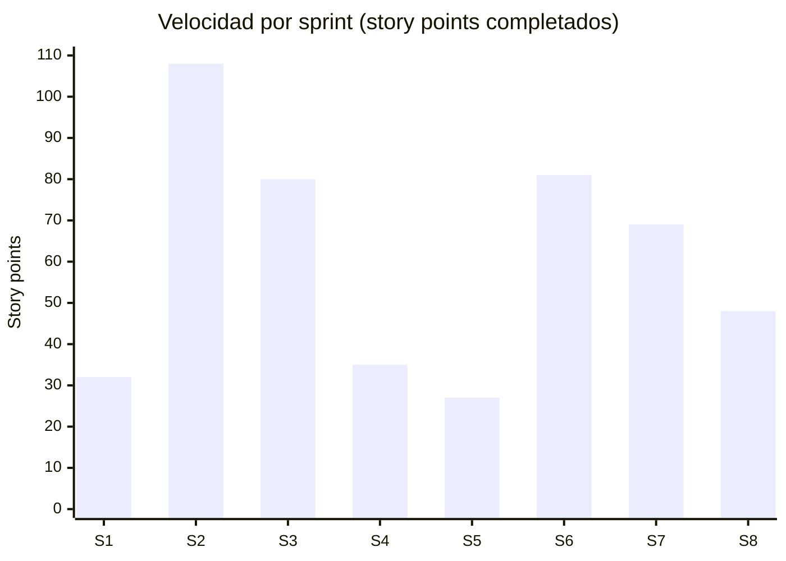

Velocidad promedio: **60 puntos/sprint** (480 puntos ÷ 8 sprints ejecutados). La caída del
Sprint 5 (27) coincide con el período de reducción del equipo; la recuperación en 6–8
muestra al equipo de 2 personas sosteniendo la entrega.

---

## 5. Cómo generar los gráficos nativos de Jira

Ni este documento ni Rovo "generan" los gráficos: viven en Jira y se sacan por captura.

1. **Board → Reports.**
2. **Sprint Report** (por sprint): muestra comprometido vs. completado **al cierre** — es
   la métrica autoritativa que acá no se puede reconstruir.
3. **Velocity Report:** compara la velocidad entre sprints (necesita story points, §4).
4. **Burndown Chart** (por sprint): el descenso del trabajo pendiente día a día.

Para la presentación: una captura del Sprint Report de cada sprint + el Velocity Report
cubre por completo el requisito de "métricas del sprint" de la hoja de ruta.


<div style="page-break-before: always;"></div>

# Anexo B — Retrospectiva del Sprint 8


**Sprint:** 8 · **Fechas:** 11/06 – 25/06/2026 · **Facilita:** Mayco Faciolo (Scrum Master)

> Redactada como acta de retrospectiva. Registra lo que pasó de verdad, incluyendo el
> impedimento central del proyecto. La honestidad de esta acta es parte de lo que se
> evalúa: un buen SM documenta los problemas, no los esconde.

---

## 1. Resumen del sprint

- **Objetivo del sprint:** cerrar el sistema de alertas por email (configuración, cron y
  event-triggered) y las automatizaciones del sistema.
- **Comprometido:** 17 issues.
- **Completado:** 17 issues (**100%**).
- **Cierre:** el sprint se cerró **después** de su fecha de fin planificada (25/06). El
  motivo se analiza en el punto 3.

Issues destacados del sprint: detección automática de riesgo de abandono (`SCRUM-214`),
autoevaluación diagnóstica por IA (`SCRUM-213`), bloqueo por morosidad (`SCRUM-209`),
alertas de mora y ausencia, y los 5 crons diarios.

---

## 2. Qué salió bien 👍

- **Tasa de finalización del 100%.** Todo lo comprometido se completó.
- **Se entregó la parte más sofisticada del sistema:** la detección de riesgo de abandono,
  que cruza asistencia, pagos y rendimiento. Responde directamente al dolor que el
  relevamiento identificó ("alumnos que abandonan sin que la institución lo detecte a
  tiempo").
- **Las automatizaciones quedaron andando** de punta a punta, incluidos los cron jobs
  diarios en Vercel.

---

## 3. Qué no salió bien 👎

- **El equipo se redujo de 4 a 2 integrantes** durante el proyecto. Este es el impedimento
  central: con la mitad de la capacidad y el mismo alcance comprometido, la velocidad real
  cayó y el cierre del sprint se corrió más allá de la fecha planificada.
- **El sprint cerró tarde.** No por falta de trabajo terminado (se completó el 100%), sino
  porque el ritmo con medio equipo no alcanzó para cerrarlo dentro de la ventana de dos
  semanas.
- **Story points sin cargar.** El equipo no estimó en puntos, así que no hay velocity ni
  burndown por puntos para medir objetivamente el impacto de la reducción del equipo en la
  velocidad.
- **Carryover no visibilizado a tiempo.** En sprints previos (5 → 6) hubo issues arrastrados
  que no se marcaron como tal en la planificación.

---

## 4. Decisiones concretas tomadas 🎯

Una retrospectiva sin decisiones no sirve. Estas son las que se tomaron a raíz de lo
anterior:

| # | Decisión | Estado |
|---|---|---|
| D1 | **Recortar alcance** ante la reducción del equipo: el portal de tutores (RF-14) y el chatbot de práctica (RF-17) pasan a Práctica III. | Aplicada |
| D2 | **Sostener el stack elegido** (Next.js/TypeScript/Supabase/Vercel) por sobre el del anteproyecto (C#/.NET/SQL Server): con medio equipo, un stack unificado y sin servidor propio es la única opción viable en el tiempo restante. | Aplicada |
| D3 | **Priorizar automatizaciones** por sobre pantallas manuales: con menos gente, que el sistema decida solo entrega más valor que una vista más. | Aplicada |
| D4 | Reconocer el cierre tardío **sin falsear la fecha del sprint**: se documenta el impedimento en esta acta en lugar de maquillar el calendario. | Aplicada |
| D5 | **Cargar story points** de ahora en adelante (y retroactivamente si se decide) para poder medir velocidad. | Pendiente |
| D6 | Abrir el **Sprint 9** con fecha real y marcar explícitamente los issues arrastrados. | Pendiente |

---

## 5. Acciones para el próximo sprint (Sprint 9) 📋

- [ ] Abrir el Sprint 9 con fechas reales.
- [ ] Definir una escala de story points simple (2/3/5) y estimar el backlog del Sprint 9.
- [ ] Implementar los cambios de reglas que pidió la Directora: umbral de asistencia 70%
      (`SCRUM-190`) y escala de notas 0–100 (`SCRUM-188`).
- [ ] Cerrar `SCRUM-231` y `SCRUM-232` (resueltos en código, aún abiertos en el board).
- [ ] Marcar en el backlog todo lo que pasa a Práctica III con la etiqueta `practica-iii`.

---

## 6. Métrica de la retro (ánimo del equipo)

Con un equipo de 2 personas y un sistema entregado y funcionando en producción, el balance
es positivo: el alcance se ajustó a la capacidad real y **no se comprometió calidad**
(159 tests en verde, typecheck limpio). El aprendizaje central: **ajustar el compromiso a
la capacidad real del equipo apenas cambia, no al final del sprint.**
